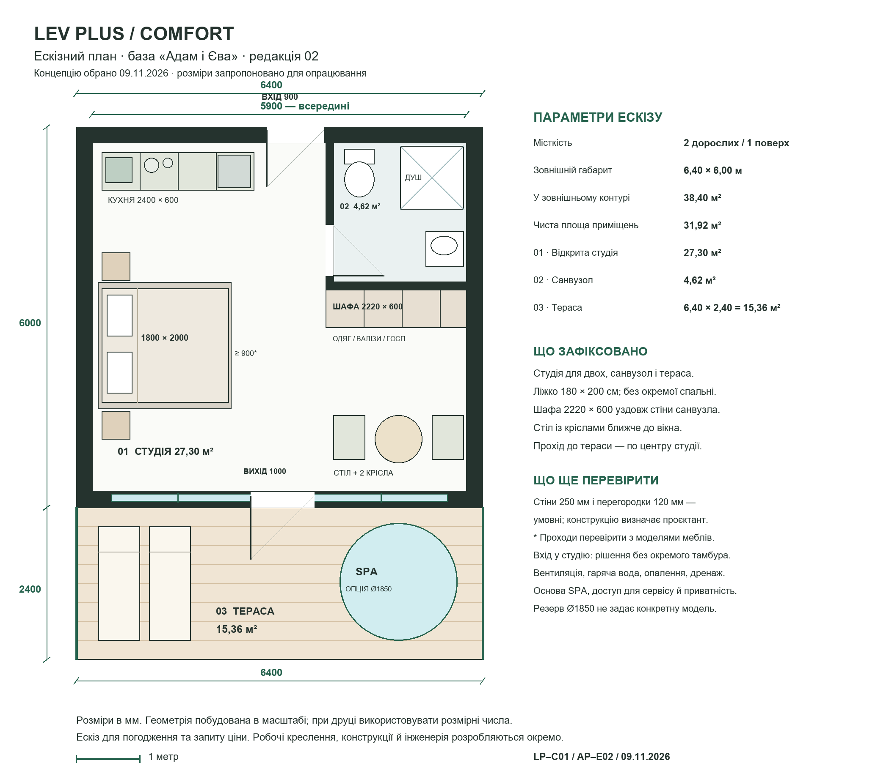
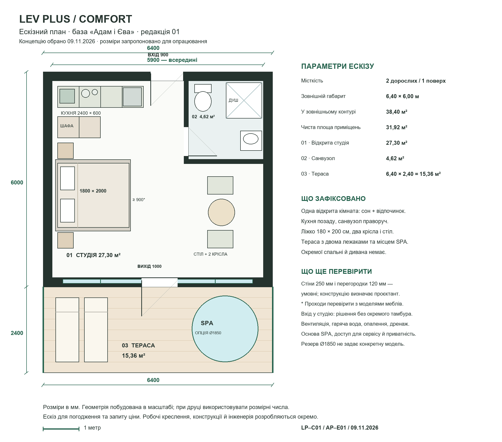
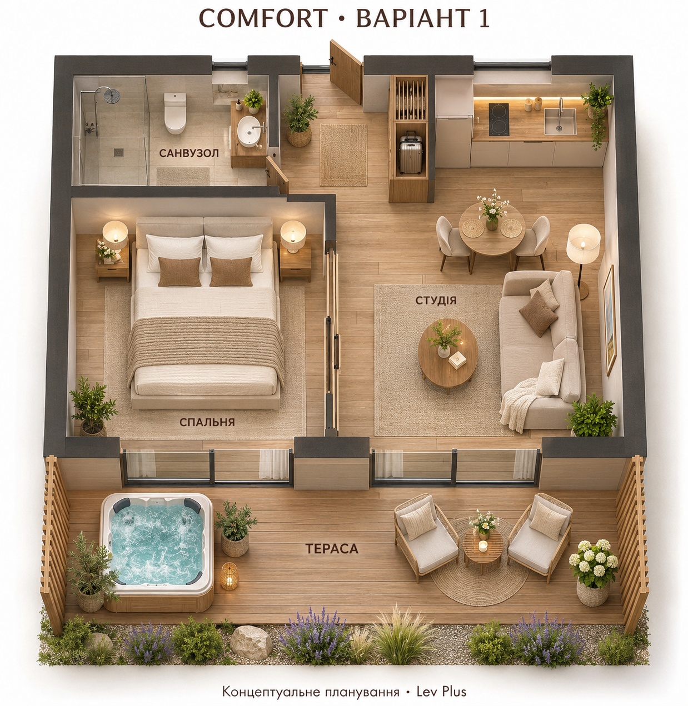

# Comfort — базова концепція

## Поточний чистовий ескіз · 09.11.2026

**Схему погоджено користувачем 09.11.2026.** Переходимо до стилізацій. [Візуал «Адам і Єва»](../interiors/01/README.md) — окремо на погодженні. Робочий проєкт і кошторис цим погодженням не затверджені.

[Comfort — концепт будинку (PNG)](comfort-concept-sketch.png) · [Векторний ескіз (SVG)](comfort-concept-sketch.svg).

Назву інтер’єрної теми з ескізу прибрано. Внутрішнє компонування збережене: ліжко відцентровано в правій ніші, TV навпроти, шафа й кухня утворюють Г-подібний блок, столик біля кухні. Тераса повернута до 6,40 × 2,40 м (15,36 м²): два крісла, квадратний столик і місце SPA. Мангал — на окремому майданчику; схема зони показана без прив’язки до ділянки. Інтегрований гриль і збільшена тераса редакції 06 відхилені користувачем.

Погоджуємо тільки ескіз. Подальша документація й розрахунки відкладені. Попередні редакції нижче — історія, не поточні рішення.

**Останній варіант на розгляд — редакція 06:** [PNG](comfort-base-plan-r06.png) / [SVG](comfort-base-plan-r06.svg). За запитом щодо інтегрованого готування запропоновано лівий терасний модуль зі стільницею та вбудовуваним вуличним електрогрилем, SPA справа, квадратний стіл і два крісла між зонами. Гриль винесений до відкритого зовнішнього кінця модуля; вугільний мангал біля фасаду не закладено. Терасу запропоновано поглибити до 3,20 м (20,48 м²); ця зміна ще не погоджена. Умови монтажу, відступи, вентиляцію та електрозахист визначати за конкретним обладнанням і проєктом; ескіз не підтверджує безпеку встановлення. Кошторис не перераховувався.

Перевірені джерела для рекомендації: [Weber — відступи від горючих матеріалів](https://webergrill.my.site.com/consumersupport/s/article/How-far-away-should-my-grill-be-from-my-house-deck-1706748209920?language=en_US), [Kenyon — монтаж вбудовуваного електрогриля](https://www.cookwithkenyon.com/electric-grill-installation-guide/). Відступи Weber не переносимо автоматично на інші моделі; електричне виконання також не скасовує вимог до монтажу. Переглянуто 09.11.2026.

**Поточна пропозиція — редакція 05:** [PNG](comfort-base-plan-r05.png) / [SVG](comfort-base-plan-r05.svg). На терасі замість лежаків — два крісла й квадратний стіл. Мангальний модуль із робочою поверхнею включено в концепцію та показано окремою вставкою без масштабу: місце й відступи ще визначатимемо. Для чотирьох стилізацій зберігаємо однакові планування та форми меблів; змінюємо кольори, фасади, оздоблення й декор. Погоджуємо тільки ескіз.

**Остання пропозиція ескізу — редакція 04:** [PNG](comfort-base-plan-r04.png) / [SVG](comfort-base-plan-r04.svg). Ліжко відцентровано між санвузлом і переднім склінням, телевізор на спільній осі з його центром. Шафу при вході та кухню зліва зібрано в єдиний Г-подібний меблевий блок; столик із двома кріслами біля кухні. Варіант для погодження; розрахунки не оновлювалися. Попередні редакції збережені нижче.

**На поточному етапі погоджуємо тільки ескіз.** Поточна пропозиція — [редакція 03 PNG](comfort-base-plan-r03.png) / [SVG](comfort-base-plan-r03.svg): ліжко віддзеркалено до правої стіни між санвузлом і вікном, TV навпроти на лівій стіні, шафа при вході, кухня вздовж лівої стіни, стіл біля переднього вікна. Це варіант для перегляду, ще не остаточне погодження. Розрахунки й подальша документація відкладені.

## Обрана база · 09.11.2026

**Поточний план — редакція 02:** [PNG](comfort-base-plan-r02.png) · [SVG](comfort-base-plan-r02.svg). За вказівкою користувача шафу перенесено на всю довжину зовнішнього боку передньої стіни санвузла; стіл із кріслами посунуто до панорамного вікна. Орієнтир шафи — 2220 × 600 мм, секції для одягу, валіз і замиканого господарського зберігання. Площі приміщень не змінилися. Редакція 01 нижче збережена як попередня.

Користувач обрав компактний формат «Адам і Єва»: одна відкрита студія для двох із ліжком, кухнею та двома кріслами, закритий санвузол, приватна тераса. Окремої спальні й дивана немає. Це рішення має пріоритет над описом попередньої альтернативи нижче.

Числові параметри ескізу редакції 01 запропоновані для погодження: 6,40 × 6,00 м у зовнішньому контурі (38,40 м²), чисті приміщення 31,92 м², тераса 15,36 м². Конструктив, інженерію та кошторис ще не затверджено.

- [Ескізний план PNG](comfort-base-plan-r01.png) · [Векторний план SVG](comfort-base-plan-r01.svg).
- [Опис бази та завдання архітектору](comfort-base-spec-r01.md).
- [Попередня вартість і джерела](comfort-budget-r01.md) · [Розрахунок CSV](comfort-budget-r01.csv).
- [Генератор креслення й розрахунку](generate_plan.py).
- [Вихідна візуальна основа](../../../../from-white/27_adam_eve_top_view.png).

## Попередня альтернатива — не обрана за базу

## Перша візуальна чернетка · 09.11.2026

Для обговорення, ще не затверджено. Поточний запит: одноповерховий будинок для двох, окрема спальня, студія з кухнею, санвузол і приватна тераса з джакузі. Попередній орієнтир — 40–44 м² усередині й 14–18 м² тераси; зображення не підтверджує площі або розміри. Наступний крок — погодити розташування зон, проходи й двері. Це концептуальна візуалізація, не будівельне креслення.

Згенеровано вбудованим image_gen. Промпт збережено у [comfort-plan-v1-prompt.txt](comfort-plan-v1-prompt.txt).

Одноповерхова студія для двох дорослих, санвузол, кухня та приватна тераса.

Статус: більша альтернатива з окремою спальнею не обрана. Обраний компактний формат описано вище.

Потрібно зібрати планування, площі, комплектацію, зовнішній вигляд і ключові обмеження для інтер’єрів. Площі та бюджет уточнюються.

Після погодження тут фіксуємо дату, учасників і посилання на остаточні матеріали.

[До типу будинку](../README.md)
