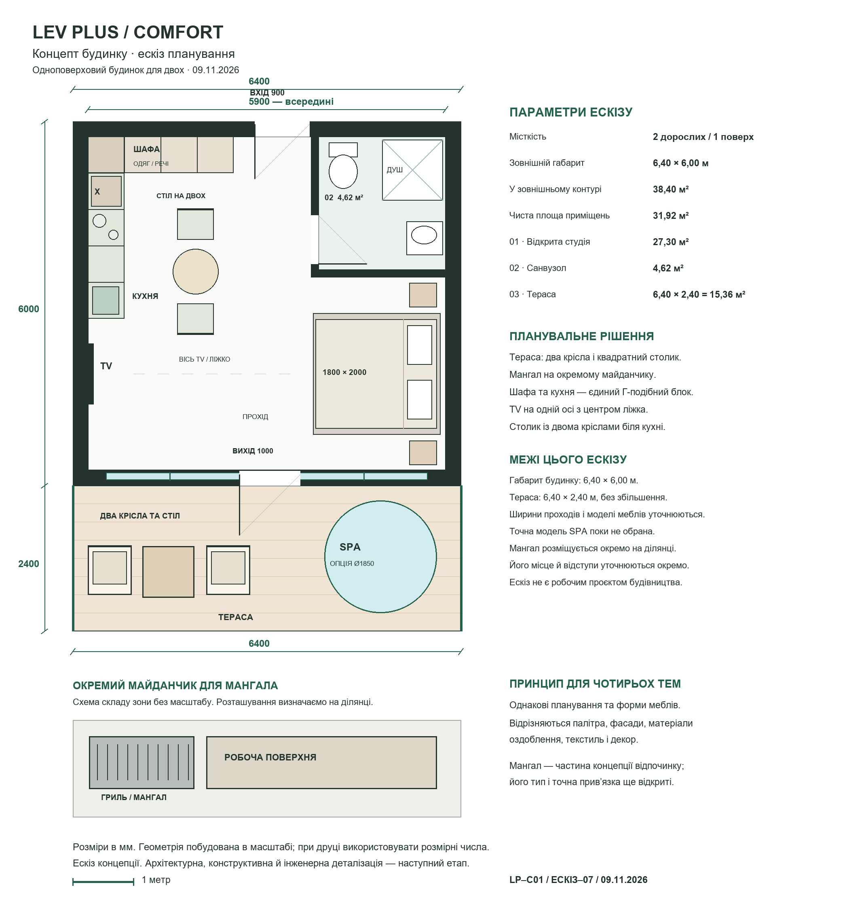

# Comfort — погоджений концепт будинку

Схему погоджено 09.11.2026.

[План PNG](comfort-concept-sketch.png) · [Векторний план SVG](comfort-concept-sketch.svg).

Один поверх, двоє дорослих, відкрита студія та закритий санвузол. Ліжко відцентровано у правій ніші, TV навпроти. Шафа при вході та кухня зліва утворюють Г-подібний блок; обідня зона біля кухні.

Габарит ескізу — 6,40 × 6,00 м: 38,40 м² у зовнішньому контурі, 31,92 м² чистих приміщень. Тераса — 6,40 × 2,40 м, 15,36 м²; два крісла, квадратний столик і місце SPA. Мангал — на окремому майданчику, його прив’язку визначаємо для обраної ділянки.

Для чотирьох інтер’єрних тем зберігаємо базову схему та форми меблів, змінюємо кольори, фасади, матеріали, текстиль і декор. У затвердженому дизайні «Адам і Єва» внутрішній стіл квадратний зі скругленими кутами, посунутий ближче до центру; його уточнення показане у візуалі.

[Погоджений дизайн «Адам і Єва»](../interiors/01/README.md).

Погодження стосується концепції. Робоча архітектурна й інженерна документація, точні моделі обладнання та кошторис — наступні етапи.

[До типу будинку](../README.md)
