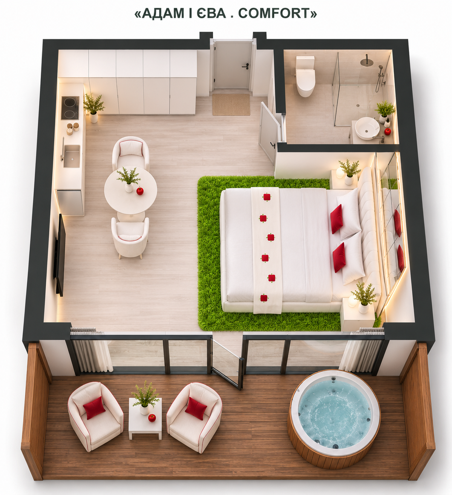

# Comfort — Адам і Єва

**Затверджено користувачем 09.11.2026:** [візуал 02](adam-eve-overview-v2.png). Поточний погоджений концепт: квадратний стіл зі скругленими кутами, легші крісла, білий інтер’єр, червоні акценти, дзеркала та зелений килим. Попередні варіанти нижче — історія. Далі Божена продовжує роботу з асистентом над іншими типами будинків.

## Поточна пропозиція — візуал 02

Для порівняння за побажанням користувача: замість круглого столу — квадратний зі скругленими кутами, орієнтовно 80 × 80 см; обідню групу посунуто ближче до центру. Два легші м’які крісла на тонких ніжках замість масивніших моделей. Решту композиції збережено. Візуал 02 затверджено користувачем; він є поточним погодженим дизайном теми.

Створено вбудованим image_gen як редагування першого візуалу. [Повний промпт](adam-eve-overview-v2-prompt.txt). Попередній варіант нижче збережено.

Назва: Адам і Єва.

Відповідальна за візуали та стилізацію: Божена.
Статус: схема та візуал 02 затверджені користувачем 09.11.2026; візуал 01 нижче — попередній.

## Візуал 01 · 09.11.2026

Геометрична основа — [погоджений ескіз](../../concept/comfort-concept-sketch.png): ліжко праворуч, TV навпроти, кухня зліва, шафа при вході, столик біля кухні, санвузол позаду праворуч. Тераса: два крісла, квадратний столик і кругла купіль. Мангал окремо, поза кадром.

Біла основа й узголів’я, білі меблі та текстиль, червоні подушки й окантовка, квадратні яблучка із зеленим листочком, дзеркала, яскраво-зелений ворсовий килим біля ліжка, рослини в білих кашпо. Взято останні стилістичні уточнення з описів White; старе розташування меблів не переносили.

Створено вбудованим image_gen. [Повний промпт](adam-eve-overview-v1-prompt.txt). Концептуальна візуалізація; дрібні пропорції уточнюються за ескізом.

Тут зберігаємо опис атмосфери, палітру, матеріали, референси та візуали. Погоджені матеріали позначаємо датою; попередні варіанти зберігаємо окремо від фінальних.

[До типу будинку](../../README.md)
