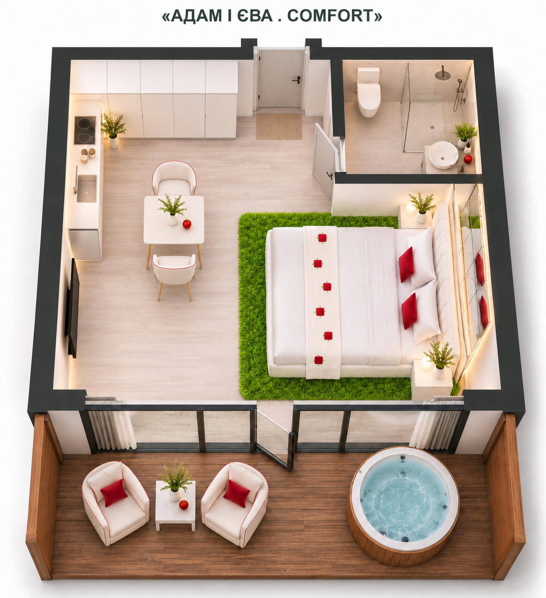

# Comfort — Адам і Єва

**Концепт затверджено 09.11.2026.** Відповідальна за подальші візуали та стилізації — Божена.

Білий інтер’єр, біле узголів’я та меблі, червоні акценти й квадратні яблучка із зеленим листочком, дзеркала за ліжком, яскраво-зелений ворсовий килим, рослини в білих кашпо.

Ліжко праворуч, TV навпроти. Шафа при вході та кухня зліва. Квадратний обідній стіл зі скругленими кутами, орієнтовно 80 × 80 см, ближче до центру; два легкі м’які крісла на тонких ніжках. На терасі — два крісла, квадратний столик і купіль. Мангал окремо, поза кадром.

Основа — [погоджений ескіз Comfort](../../concept/README.md). Зображення є концептуальною візуалізацією; точні розміри та моделі уточнюються під час деталізації.

Створено вбудованим image_gen. [Промпт затвердженого візуалу](prompt.txt).

Далі Божена працює з асистентом над іншими типами й стилізаціями будинків.

[До типу будинку](../../README.md)
