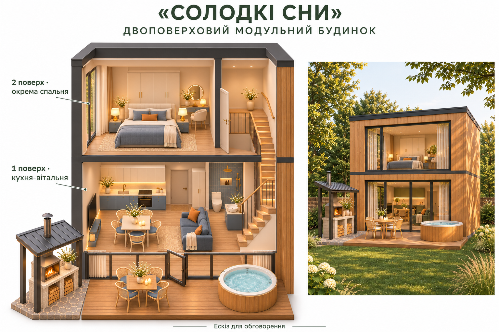

# «Солодкі сни» — квадратний двоповерховий модульний будинок

17.11.2026 користувачка замовила новий ескіз другого типу: квадратний модульний корпус на два повноцінні поверхи, студія та окрема спальня. За основу подачі взято попередній одноповерховий варіант «Солодких снів».

**Статус: ескіз для обговорення; погодження цього варіанта ще немає.**

- Перший поверх: кухня-вітальня з розкладним диваном, обідній стіл на чотирьох, закритий санвузол і внутрішні сходи.
- Другий поверх: окрема закрита спальня з дверима, двоспальним ліжком, шафою, тумбочками й туалетним столиком; сходовий майданчик перед входом.
- Корпус: квадратний у плані, два повноцінні рівні, плоский дах із графітовим краєм, дерев’яний фасад і панорамне скління.
- Зовні: тераса зі столом на чотирьох і купіллю, мангал під окремим навісом.

Розріз умовний: частину стін прибрано для огляду. Розміри, площі, геометрія сходів, огородження, двері санвузла, конструкція модулів та інженерія потребують окремого розмірного плану. Зображення не є робочим проєктом і не підтверджує технічну здійсненність деталей.

Створено вбудованим ImageGen. [Повний запит](01-concept-prompt.txt). Референси — [одноповерховий розріз](../single-storey/walkthrough/01-house-cutaway.png) і [зовнішній вигляд](../single-storey/04-terrace-from-yard.png).

[До базової концепції](../../README.md)
