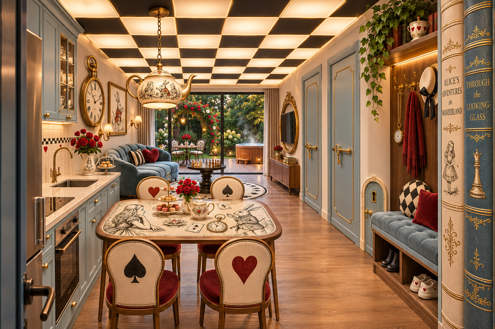
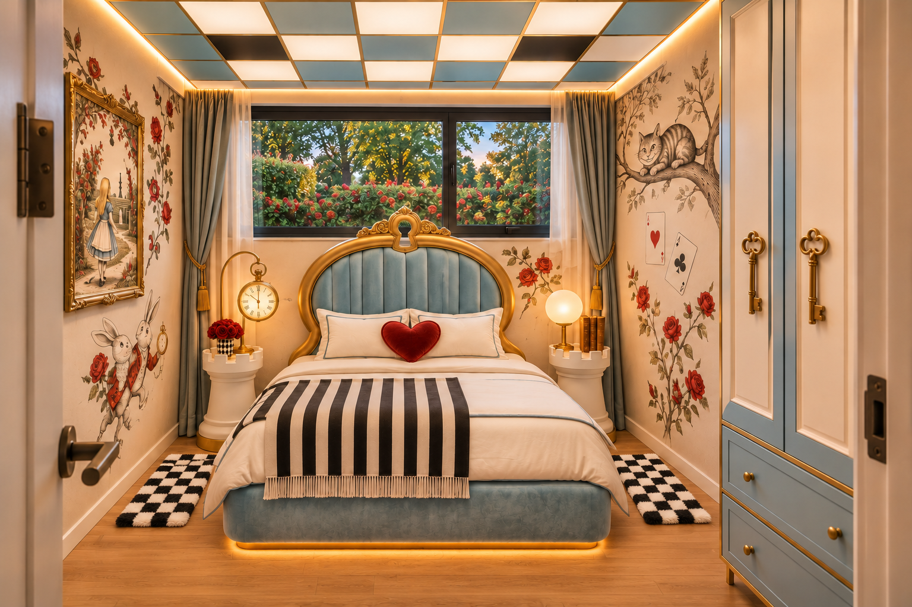
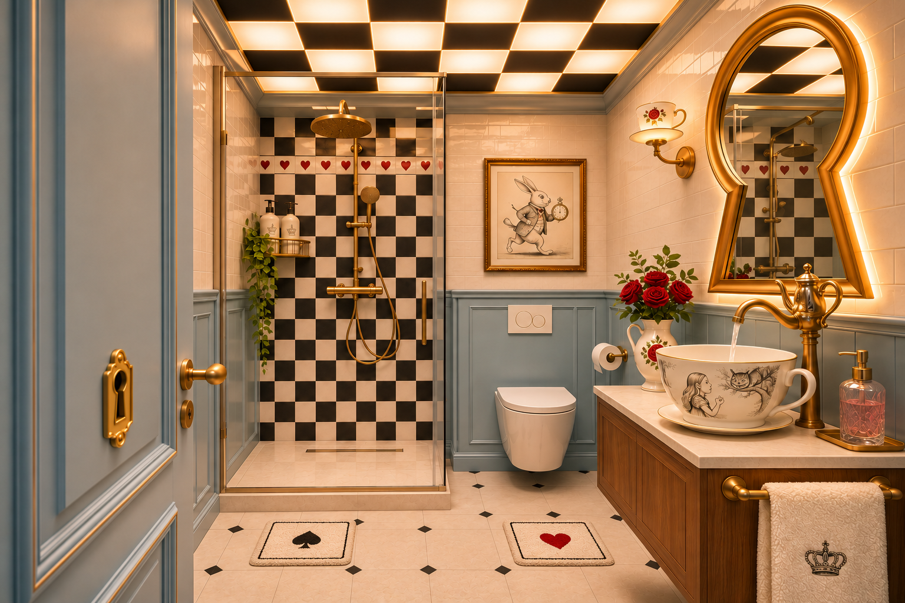
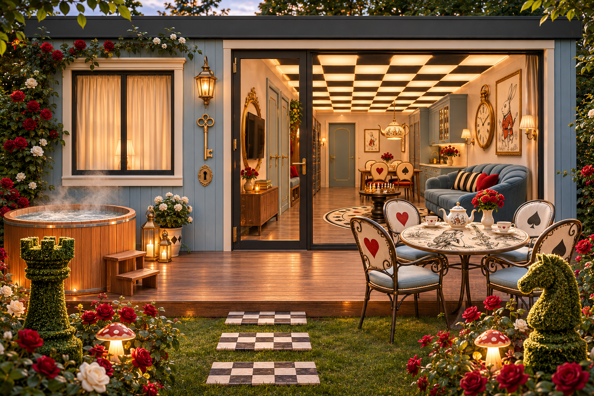
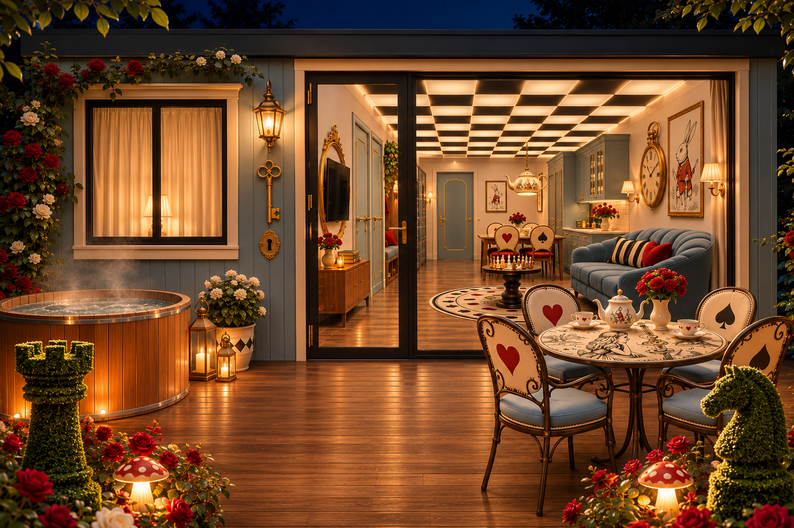

# Аліса в Країні чудес / Alice in Wonderland

**Усе збережено для обговорення Божени з Тарасом 18.11.2026.** [Варіант 2 - шахова підлога, гладка стеля, уточнений санвузол, TV без рамки й накрита тераса з мангалом](variant-02-checkerboard-floor/README.md). Нижче збережено перший варіант зі світловою шаховою стелею; обидва доступні для порівняння. Остаточний вибір - після спільного обговорення.

17.11.2026. Окрема стилізація останнього одноповерхового модульного будинку з однією закритою спальнею, кухнею-студією, душовою/WC та терасою. Назву й тему запропонувала Божена. Перша серія з чотирьох ракурсів підготовлена для обговорення; фінальне оформлення ще не погоджене. [«Будинок чудес»](../house-of-wonders/README.md) збережено як окремий варіант.

**Уточнення першого варіанта:** [спальня з двома ворсистими килимками в клітинку](02-alice-bedroom-small-rugs-v02.png) · [проміжний санвузол із двома меншими килимками](03-alice-bathroom-small-mats-v02.png) · [нічний вигляд із тераси](05-alice-night-from-terrace-v01.png). В останньому уточненні [санвузла варіанта 2](variant-02-checkerboard-floor/03-alice-bathroom-single-mat-v03.png) Божена повернула один килимок із серцем; спальня залишається з двома маленькими.

## Історія інтер’єру

Чаювання Капелюшника, Білий Кролик із годинником, ключ і замкова щілина, карткові масті, шахи, Чеширський Кіт та сад червоних і білих троянд. Візуальні мотиви книжкової Аліси об’єднують усі приміщення.

Палітра: блакитний і сіро-блакитний, вершковий, чорний, вишневий та тепла позолота. Підлога під дерево, панельні фасади, оксамитові акценти, тонкі книжкові ілюстрації й декоративна порцеляна.

### 01 - перше враження від входу

За побажанням Божени стеля над кухнею й студією має **шахові квадрати з підсвічуванням**: світлові молочні панелі чергуються з темними. Над столом світильник-чайник. На самій стільниці - захищені прозорим покриттям ілюстрації Аліси, Кролика, карт та годинника; навколо чотири крісла з мастями.

Кухня блакитна з порцеляновими акцентами, диван оксамитовий. Годинник-кишеньковий годинник і малюнок Кролика позначають зону відпочинку. TV обрамлено позолоченою овальною рамою. При вході праворуч шафа у вигляді книжкових корінців, банкетка й зберігання взуття фасадами до людини. Маленькі декоративні дверцята біля підлоги - ігрова деталь; справжні двері спальні та санвузла поруч, повнорозмірні.

### 02 - спальня за золотим ключем

Великий килим під ліжком прибрано. По боках ліжка два окремі невеликі килимки з довгим пухнастим ворсом у чорно-білу клітинку; біля підніжжя відкрита дерев’яна підлога. Орієнтовний розмір у запиті - 45 × 75 см кожен, фактичний виріб ще добираємо. [Початковий кадр із великим килимом](02-alice-bedroom-v01.png) залишено для порівняння.

Блакитне ліжко з м’якою основою й позолоченим узголів’ям із мотивом замкової щілини; знизу тепле світло та прихована реальна опора. По боках тумби у вигляді шахових тур. Над ліжком продовжується квадратна світлова стеля у блакитно-молочній гамі.

На стінах книжкова Аліса, Білий Кролик, Чеширський Кіт і троянди. Ручки шафи - декоративні ключі. Вікно, закритість спальні та місце шафи збережено як основу.

### 03 - санвузол Задзеркалля

Замість великого килимка показано два компактні з простими картковими малюнками: чорна піка перед душовою й червоне серце біля умивальника. Обидва лежать зовні душової кабіни. Орієнтир у запиті - близько 35 × 50 см кожен, короткий махровий ворс. Зменшення зроблено за побажанням Божени для стриманішої комплектації; конкретну економію без вибору виробів не рахували. [Початковий кадр](03-alice-bathroom-v01.png) збережено окремо.

Душова кабіна з прозорим склом і шаховою плиткою, звичайний туалет, умивальник у формі великої чашки й кран із мотивом чайника. Над умивальником велике дзеркало у формі замкової щілини з теплим ореолом. Шахова підсвічена стеля, блакитні панелі, бордюр із червоними сердечками та малюнок Кролика продовжують загальну тему. Умивальник, дзеркало, туалет і душова обов’язково залишаються в комплектації; конкретні моделі ще не обрано.

### 04 - тераса для чаювання

Блакитний дерев’яний фасад і плоский графітовий дах. На терасі купіль, ілюстрований столик і чотири крісла з картковими мастями. Навколо троянди, шахові топіарії та світильники-грибочки, до настилу ведуть окремі шахові крокові плити.

Із цього зворотного ракурсу вікно спальні ліворуч закрито шторою, студія видима праворуч. Усередині диван праворуч, TV на перегородці навпроти, кухня й обідній стіл глибше. Будинок залишається одноповерховим модульним корпусом.

### 05 - нічний вигляд із тераси

Погляд від зовнішнього краю тераси в бік фасаду й освітленої студії. Шахова стеля, світильник-чайник і бра формують теплий інтер’єр; зовні світяться ліхтарі та садові грибочки, на воді купелі видно відблиски. Розташування терасового столу, купелі та заштореного вікна спальні збережено за попереднім зовнішнім ракурсом. Це візуальна пропозиція вечірнього освітлення, світлотехнічний розрахунок ще не виконаний.

## Основа та статус

[Базове планування](../../concept/layout-variants/single-storey/entry-redesign/README.md): кухня й студія ліворуч, зберігання праворуч від входу, санвузол праворуч ближче до входу, окрема спальня за ним. У кожної закритої кімнати свої двері зі спільної зони. Вихід на терасу - зі студії.

Це концептуальні зображення, не розмірний проєкт. Дрібні пропорції, графіку й предмети між кадрами ще потрібно узгодити. Висоту та будову світлової стелі, проходи, виконання меблів, умивальника й крана перевіряємо під час робочого проєктування. Декоративне світло передбачається регулювати окремо від робочого.

[Попередній кошторис базового будинку](../../concept/layout-variants/single-storey/entry-redesign/sweet-dreams-latest-layout-budget-2026-11-17.md) складено до цієї стилізації. Шахову світлову стелю, індивідуальні меблі, художні покриття, спеціальну сантехніку й тематичне озеленення за ним окремо не перевіряли; доплату визначаємо після вибору дизайну.

## Досліджені інтерпретації

Відкриті джерела переглянуто 17.11.2026:

- [Cowley Manor, CHZON / Dorothée Meilichzon](https://www.chzon.com/cowley-manor) - геометрія, шахові мотиви, виразні кольори та поєднання класичних і сучасних форм. Це натхнення для власної композиції.
- [Історичний Alice in Wonderland у Токіо, Fantastic Design Works](https://www.homedsgn.com/2011/04/25/restaurant-alice-in-wonderland-in-tokyo-by-fantastic-design-works/) - приклад тематичних зон на основі сцен Аліси. [Офіційна сторінка Alice in a Labyrinth](https://www.dd-holdings.jp/shops/alice/meikyuginza) нині позначає заклад як закритий; використовуємо його як архівний дизайнерський приклад.
- [Всередині виставки V&A «Alice: Curiouser and Curiouser»](https://www.vam.ac.uk/articles/inside-the-alice-curiouser-and-curiouser-exhibition) - чаювання, карти, костюми та Задзеркалля як послідовна просторова розповідь.

## Генерація

Створено вбудованим ImageGen. Запити: [студія](01-alice-studio-entry-v01-prompt.txt), [спальня](02-alice-bedroom-v01-prompt.txt), [санвузол](03-alice-bathroom-v01-prompt.txt), [тераса](04-alice-terrace-v01-prompt.txt).

Уточнення: [два ворсисті килимки спальні](02-alice-bedroom-small-rugs-v02-prompt.txt), [компактні килимки санвузла](03-alice-bathroom-small-mats-v02-prompt.txt), [нічний вигляд](05-alice-night-from-terrace-v01-prompt.txt). Для редагування килимків використано відповідні кадри v01; для ночі - денний вигляд тераси та студію Аліси.

Локальні референси: план `03-smaller-bathroom-storage.png` та нейтральні ракурси `01-entry.png`, `05-bedroom-doorway.png`, `04-bathroom-from-door.png` з папки базового планування. Для санвузла й тераси додатково використано вже створену студію цієї серії. Фотографії вебджерел у генератор не передавалися. [Уточнення запитів та ролей референсів](generation-notes.md).

[До другого типу](../../README.md).
