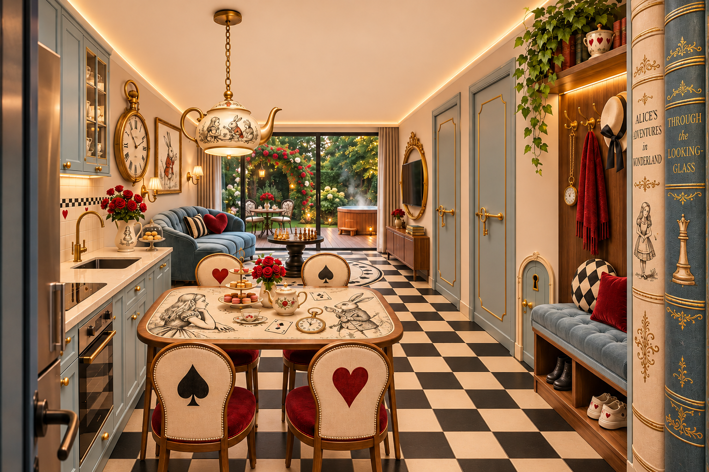
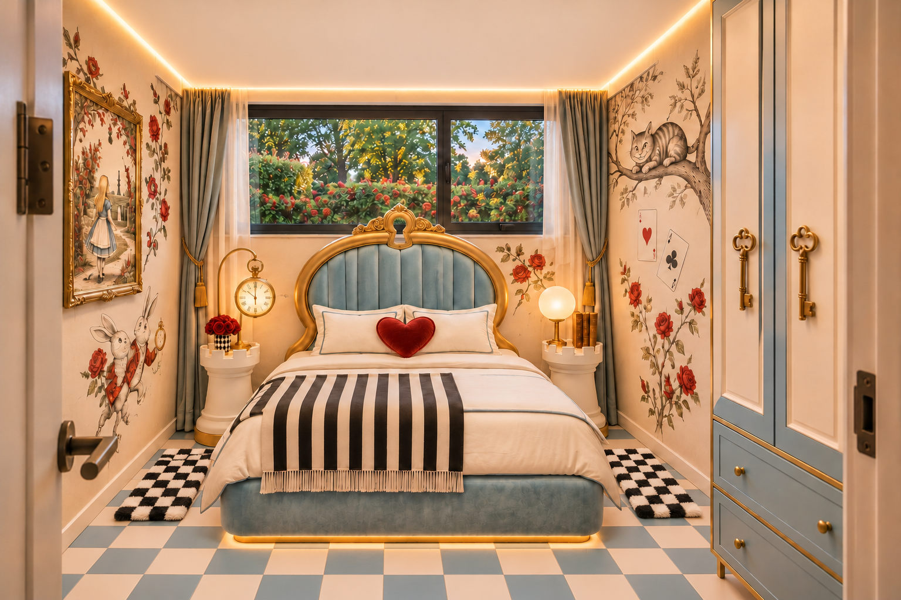
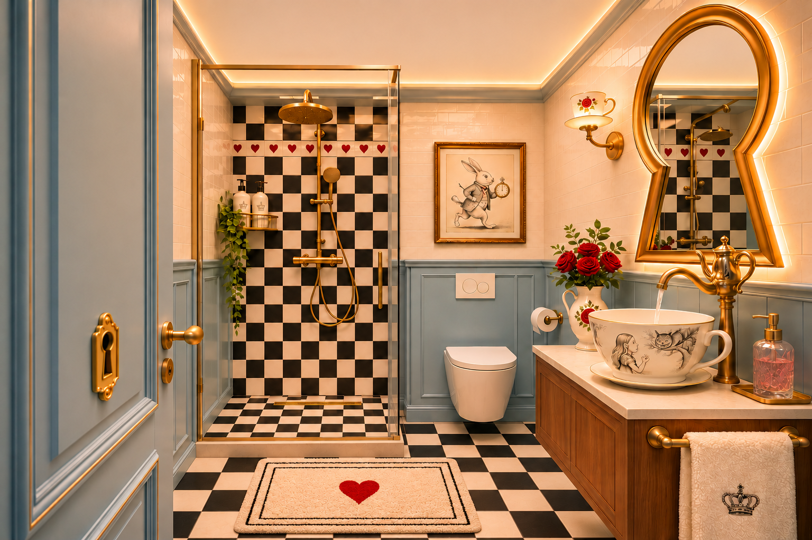
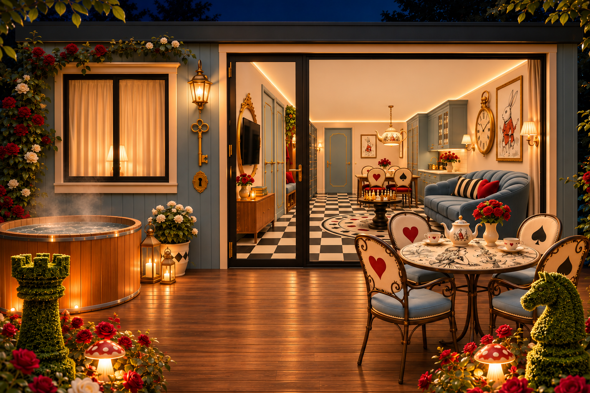
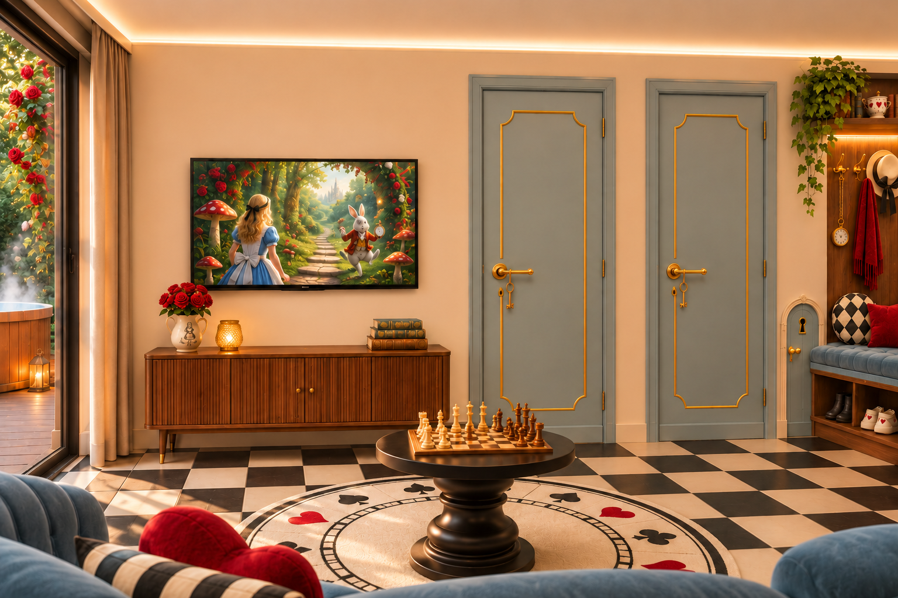
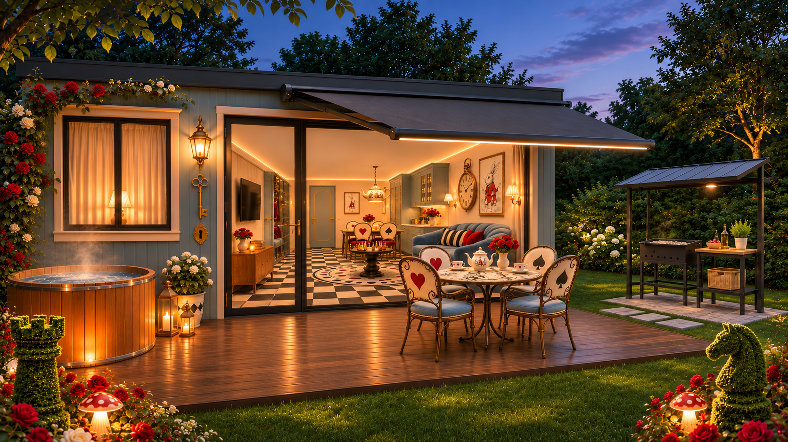
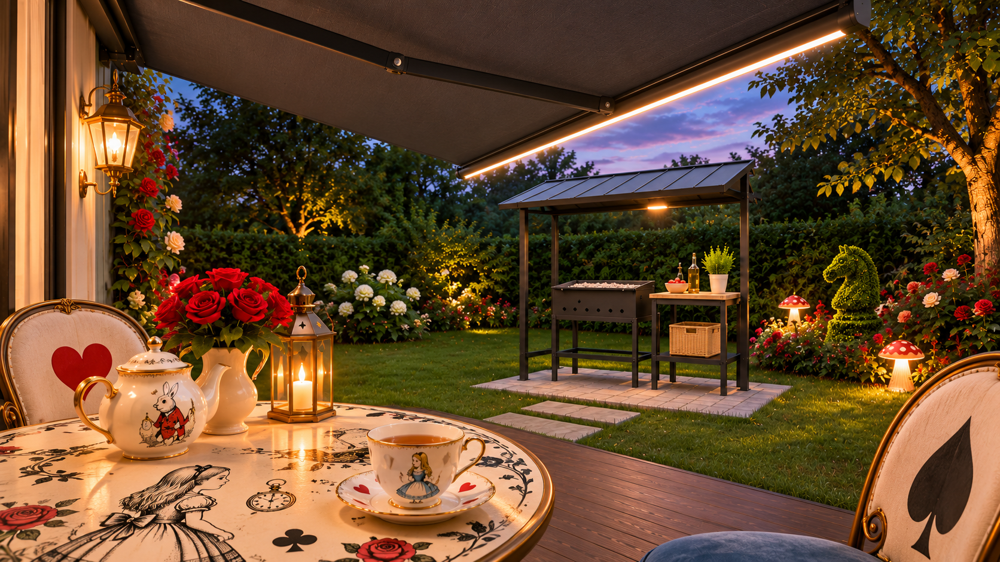

# Аліса в Країні чудес - варіант 2

**Шахова підлога та гладка світла стеля.** Збережений комплект від 17.11.2026 для обговорення Божени з Тарасом 18.11.2026. Остаточний вибір оформлення ще попереду. [Перший варіант і всі матеріали «Аліси»](../README.md).

## Що змінили

- У передпокої, кухні-студії та санвузлі квадратна чорно-біла плитка на підлозі; у спальні біло-блакитна.
- Стеля гладка біла з тонкою теплою підсвіткою по периметру. Шахові світлові панелі зі стелі прибрано.
- **У спальні залишаються два маленькі ворсисті килимки в чорно-білу клітинку.** За останнім уточненням Божени зміна на один килим стосується саме санвузла.
- **У санвузлі один килимок із червоним серцем**, як у початковому кадрі, замість двох маленьких. Умивальник-чашка, дзеркало-замкова щілина, душова й туалет збережені.
- Додано вигляд із дивана на TV, окремо випробувано TV без круглої золотої рамки. Обидва оформлення збережено для порівняння.
- На терасі запропоновано графітову висувну маркізу над столиком і чотирма кріслами. Купіль збоку, поруч із терасою простий чорний мангал зі столиком під окремим легким навісом. Є загальний вигляд та ракурс із крісла під маркізою.

## Ракурси для зустрічі

| № | Що показано | Кадр |
|---|---|---|
| 01 | Вхід, кухня та студія; чорно-біла підлога, гладка стеля | [Відкрити](01-alice-studio-checkerboard-floor-v02.png) |
| 02 | Спальня з біло-блакитною підлогою й двома маленькими килимками | [Відкрити](02-alice-bedroom-blue-checkerboard-floor-v02.png) |
| 03 | Санвузол з одним килимком із серцем - останнє уточнення | [Відкрити](03-alice-bathroom-single-mat-v03.png) |
| 04 | Нічний вигляд відкритої тераси | [Відкрити](04-alice-night-checkerboard-floor-v02.png) |
| 05 | Що бачимо з дивана; TV без декоративної рамки | [Відкрити](05-alice-from-sofa-tv-no-frame-v02.png) |
| 06 | Тераса з маркізою, купіллю та окремою мангальною зоною | [Відкрити](06-alice-covered-terrace-grill-overview-v01.png) |
| 07 | Вигляд із крісла під маркізою в бік мангала й саду | [Відкрити](07-alice-covered-terrace-from-chair-v01.png) |

### 01 - студія

### 02 - спальня

### 03 - санвузол, останнє уточнення

### 04 - будинок уночі

### 05 - з дивана на TV без рамки

Телевізор прямо навпроти дивана. Праворуч від нього двері спальні, далі двері санвузла; в крайньому правому фрагменті зберігання при вході. Ліворуч скління на терасу. [Той самий ракурс із золотою рамкою](05-alice-from-sofa-to-tv-v01.png) збережено для порівняння. У раніших кадрах 01 та 04 рамка ще присутня; рішення щодо неї випробувано окремо, усю серію ще не уніфікували.

### 06 - загальний вигляд накритої тераси

Запропоновано висувну графітову тканинну маркізу з тонкими шарнірними опорами над обідньою частиною. Це варіант накриття, а не суцільний капітальний дах усієї тераси. Мангал - проста металева жаровня на ніжках і невеликий робочий столик на окремому мощеному майданчику, зі своїм відкритим навісом; поза тканинною маркізою. Габарити й обладнання ще уточнюються.

### 07 - із крісла на мангальну зону

Камера під маркізою біля столика, видно накриття над головою, тематичний посуд, крісла-карти та простий мангал у саду. Купіль із протилежного боку тераси в цей ракурс не входить.

## Для порівняння

- [Проміжний санвузол із двома маленькими килимками](03-alice-bathroom-checkerboard-floor-v02.png) - до останнього уточнення Божени; поточним є кадр з одним килимком.
- [Вигляд із дивана з круглою золотою рамкою](05-alice-from-sofa-to-tv-v01.png) - альтернатива кадру без рамки.
- [Початковий варіант «Аліси» із шаховою стелею](../README.md).

## Що обговорити з Тарасом

1. Шахова підлога й гладка стеля другого варіанта чи світлова шахова стеля першого.
2. TV із круглою рамкою чи без неї.
3. Маркіза над столиком, положення купелі та окремого мангала; чи підходить саме таке накриття.
4. Які тематичні деталі зберігаємо й які матеріали обираємо перед уточненням бюджету.

Візуали концептуальні, не розмірний чи світлотехнічний проєкт. Між кадрами можливі відмінності дрібних пропорцій і предметів. Мета спрощення стелі та вибору простого мангала - стриманіша комплектація; фактичну економію, ціну плитки й маркізи ще не рахували. Попередній базовий кошторис не підтверджує вартість цих індивідуальних рішень.

Створено вбудованим ImageGen. Усі використані основні запити збережено поруч у файлах `*-prompt.txt`. [Референси та додаткові вказівки](generation-notes.md).
