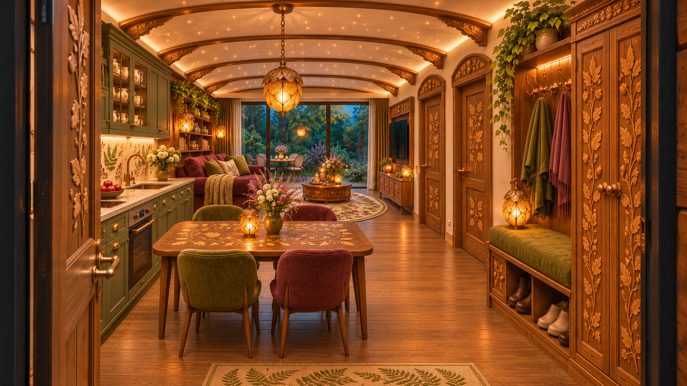
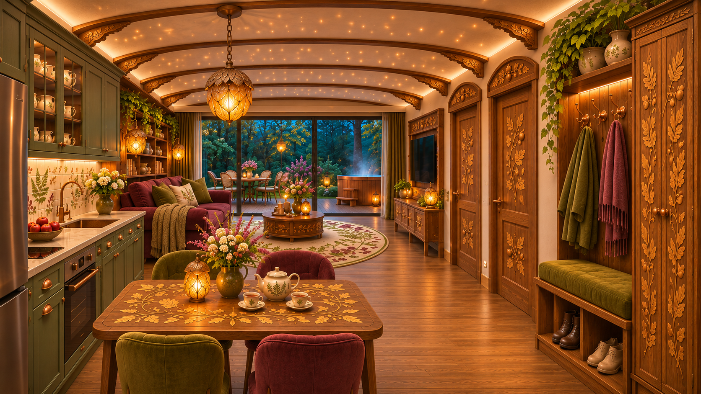
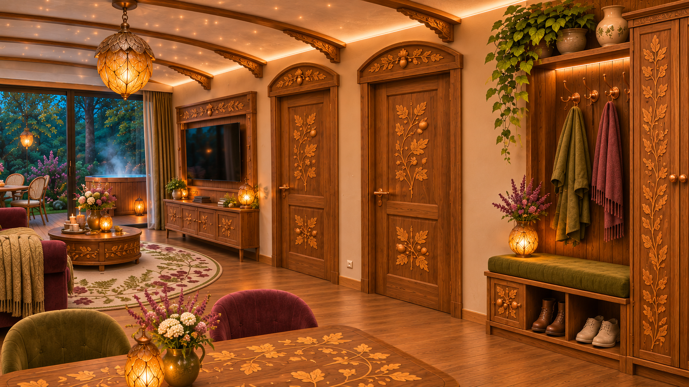
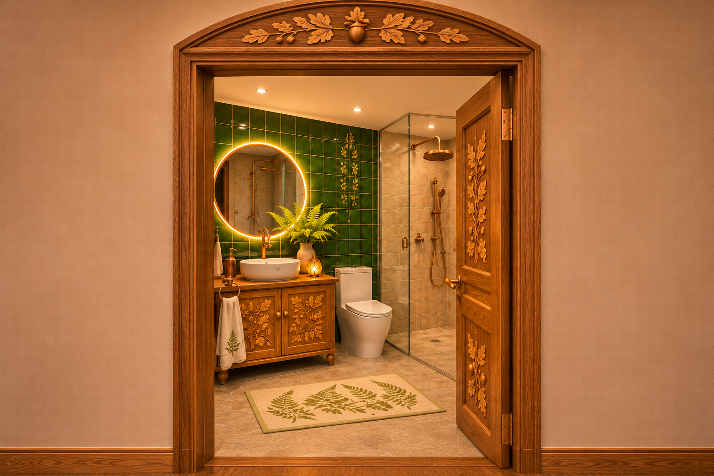
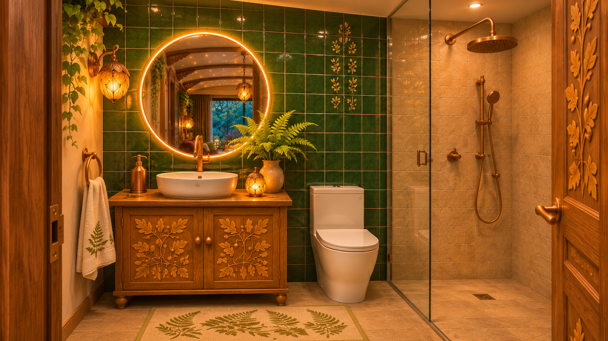
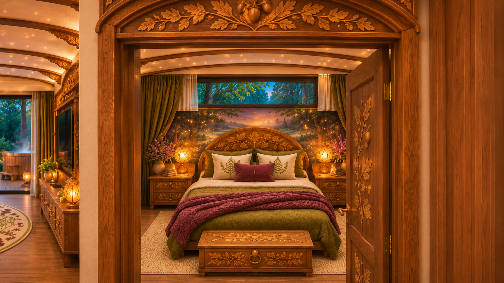
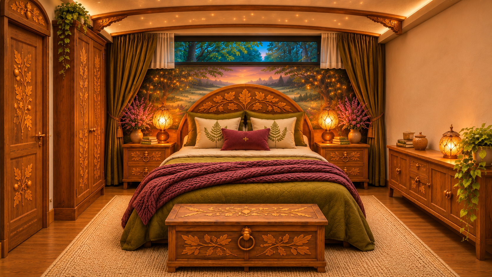
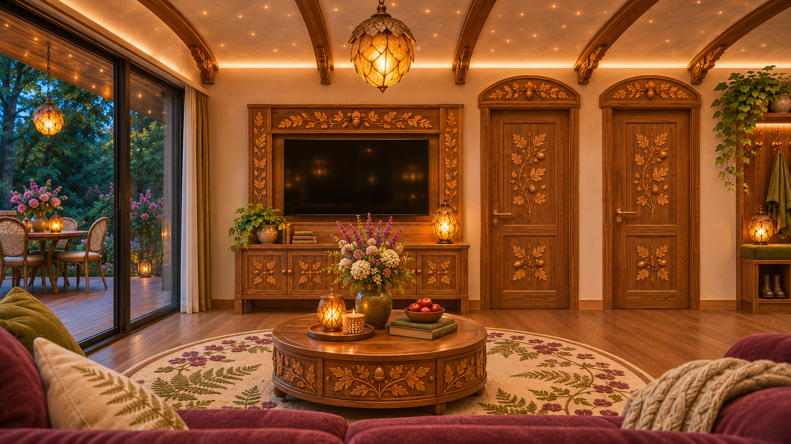
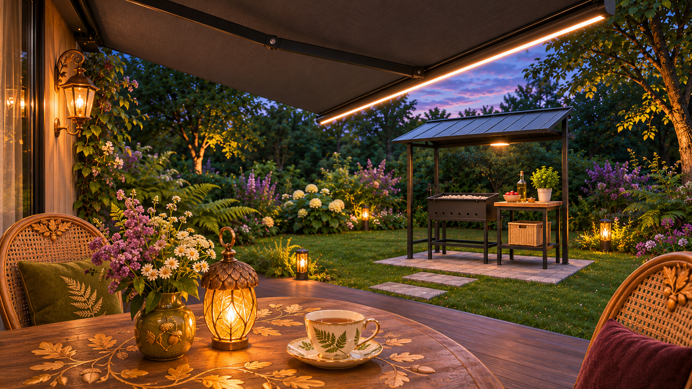
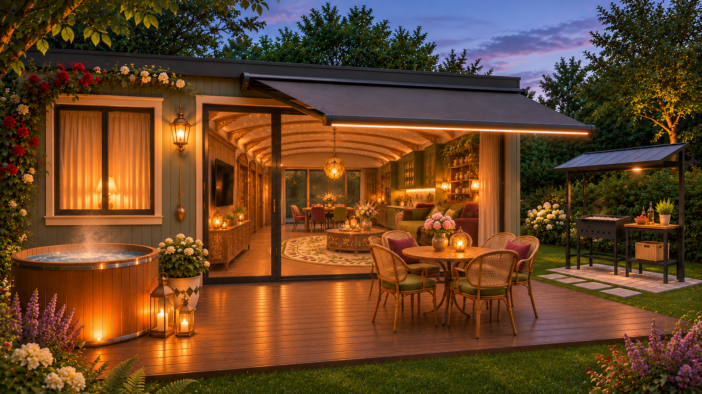

# Хобітленд — 10 окремих ракурсів

18.11.2026. Комплект створено на пряме замовлення Божени: вхід, спільний прохід, сусідні двері, вхід і середина санвузла, вхід і середина спальні, вигляд із дивана, вигляд із крісла на терасі та загальна накрита тераса з мангалом. Дизайн і технічні деталі для обговорення.

## Ракурси

| № | Що показано | Файли |
|---|---|---|
| 01 | Відчиняємо вхідні двері | [Зображення](01-open-front-door.png) · [Запит](01-open-front-door-prompt.txt) |
| 02 | Передпокій і загальний прохід | [Зображення](02-entry-passage-to-studio.png) · [Запит](02-entry-passage-to-studio-prompt.txt) |
| 03 | Що бачимо з проходу — двоє сусідніх дверей | [Зображення](03-passage-adjacent-doors.png) · [Запит](03-passage-adjacent-doors-prompt.txt) |
| 04 | Вхід у санвузол | [Зображення](04-bathroom-doorway-v02.png) · [Запит](04-bathroom-doorway-v02-prompt.txt) |
| 05 | Усередині санвузла | [Зображення](05-bathroom-interior.png) · [Запит](05-bathroom-interior-prompt.txt) |
| 06 | Вхід у закриту спальню | [Зображення](06-bedroom-doorway.png) · [Запит](06-bedroom-doorway-prompt.txt) |
| 07 | Усередині спальні | [Зображення](07-bedroom-interior-v02.png) · [Запит](07-bedroom-interior-v02-prompt.txt) |
| 08 | Сидимо на дивані — дивимось на TV | [Зображення](08-seated-sofa-to-tv.png) · [Запит](08-seated-sofa-to-tv-prompt.txt) |
| 09 | Сидимо в кріслі на накритій терасі | [Зображення](09-covered-terrace-from-chair.png) · [Запит](09-covered-terrace-from-chair-prompt.txt) |
| 10 | Накрита тераса й попередній мангал | [Зображення](10-covered-terrace-grill-overview.png) · [Запит](10-covered-terrace-grill-overview-prompt.txt) |

## Уточнення користувачки

- Зберігання праворуч від головного входу: **вертикальна висока шафа**, гачки для курток, низька банкетка й відкриті взуттєві ніші під нею. Дверцята, гачки та ніші звернені до людини, що заходить; тильна сторона до стіни. Взуття ставимо в доступні спереду ніші, верхній одяг вішаємо на гачки або у шафу. [Уточнений загальний ескіз v02](../01-hobbitland-cutaway-storage-v02.png).
- «Коридор» показано як спільний відкритий прохід у студії. Нового закритого коридора не додавали. З нього два незалежні входи у приватні кімнати: санвузол ближче до головного входу, спальня далі до тераси.
- Кадр 08 показує погляд із сидіння дивана прямо на TV; праворуч від нього двері спальні й санвузла.
- У кадрах 09–10 над столиком і кріслами графітова висувна тканинна маркіза, як у попередній «Алісі». Купіль збоку; мангал окремо на мощеному майданчику під своїм відкритим металевим навісом. Накриття над сидінням — маркіза, а не капітальний дах усієї тераси.
- Мангал відтворено за попереднім референсом: проста чорна прямокутна металева жаровня на ніжках, поруч робочий столик і нижня полиця/кошик. Кладку чи велику піч не додавали.

## Перевірка та межі ескізів

Усі кадри переглянуто після генерації. Для кадру 04 обрано ближчий вхід у санвузол v02: у першій спробі зберігання стояло між входами, що суперечило схемі. Для кадру 07 обрано v02, де прибрано додане бічне вікно й узгоджено верхнє прямокутне вікно над узголів’ям із кадром 06. Попередні спроби `04-bathroom-doorway.png` і `07-bedroom-interior.png` залишено поруч лише як чернетки; у комплект входять файли з `v02`.

Це художні генеративні ракурси одного задуму, не комплект робочих креслень. Між зображеннями ще можуть відрізнятися пропорції, декор, відбиття та деталі скління. Верхнє вікно спальні на кадрах 06–07 — деталь ескізної подачі, не погоджене переоблаштування фасаду; потрібне звіряння з єдиною розгорткою та початковим склінням. Ці кадри не підтверджують точні розміри, проходи й дверні дуги. Планування, шафи, вікна, меблі та навіс остаточно узгоджуємо на одному розмірному плані. Бюджет і технічні розрахунки цього комплекту не виконували.

## Генерація й локальні референси

Створено вбудованим ImageGen, кожен ракурс окремим викликом. Повні запити містяться поруч, посилання в таблиці. Основа — [уточнений вигляд згори](../01-hobbitland-cutaway-storage-v02.png) і [перша студія від входу](../02-hobbitland-studio-entry-v01.png). Для санвузла додатково використано першу спробу кадру 04 як референс оздоблення; для уточнення спальні — кадри 06 і першу спробу 07.

Зразки мангала, маркізи та зовнішніх ракурсів — [тераса «Аліси»](../../alice-in-wonderland/variant-02-checkerboard-floor/06-alice-covered-terrace-grill-overview-v01.png) і [вигляд із крісла](../../alice-in-wonderland/variant-02-checkerboard-floor/07-alice-covered-terrace-from-chair-v01.png). Їхній тематичний декор замінено на мотиви «Хобітленду».

## 01 — Відчиняємо вхідні двері

## 02 — Передпокій і загальний прохід

## 03 — Що бачимо з проходу — двоє сусідніх дверей

## 04 — Вхід у санвузол

## 05 — Усередині санвузла

## 06 — Вхід у закриту спальню

## 07 — Усередині спальні

## 08 — Сидимо на дивані — дивимось на TV

## 09 — Сидимо в кріслі на накритій терасі

## 10 — Накрита тераса й попередній мангал

[До Хобітленду](../README.md)

