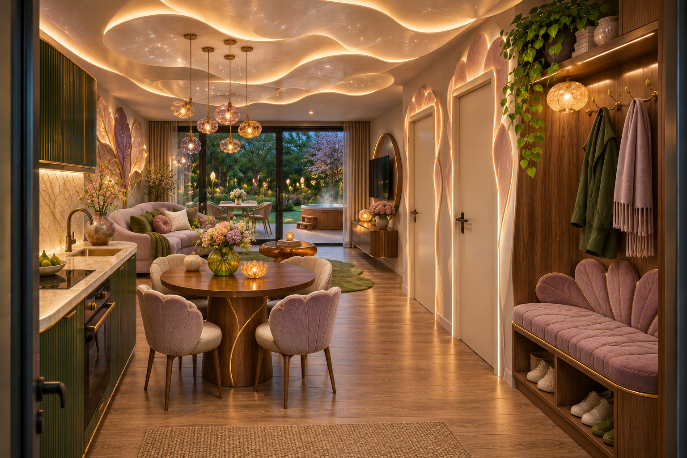
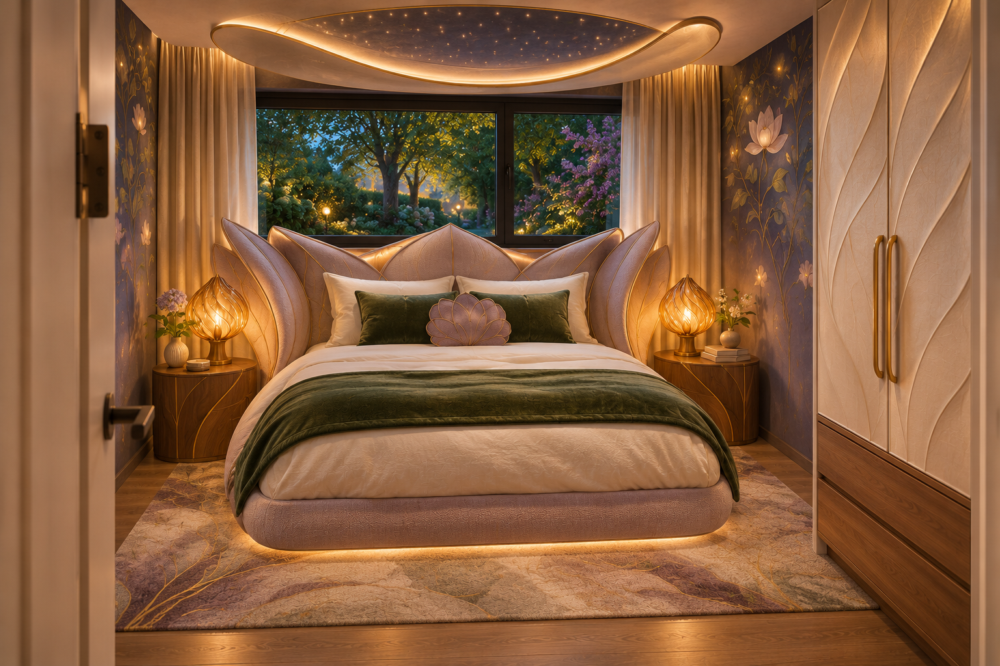
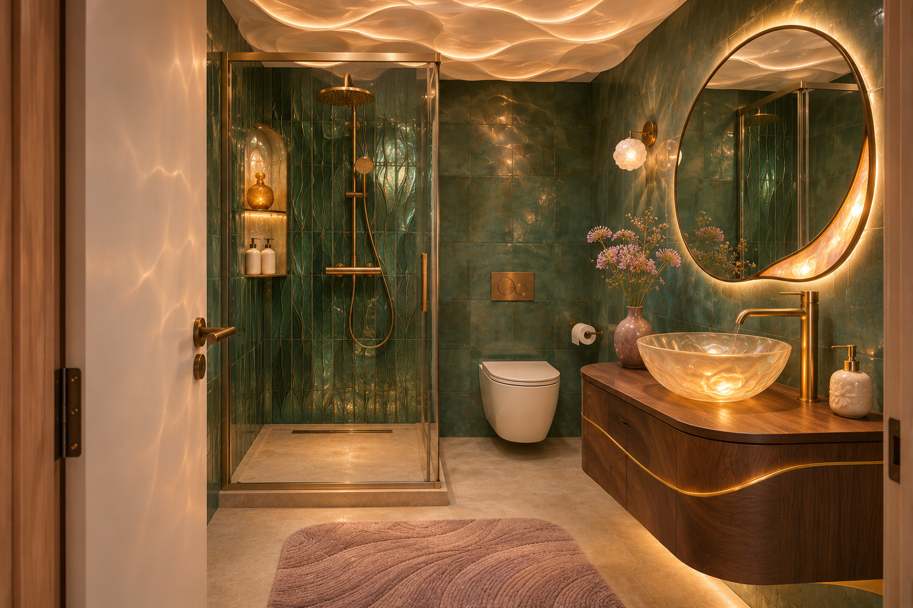
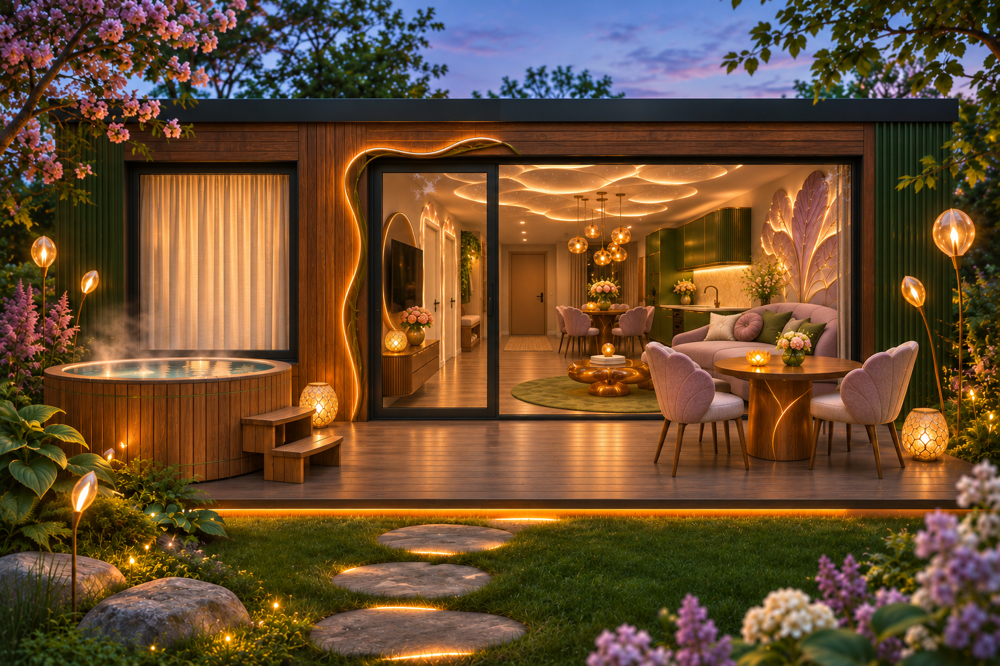

# Будинок чудес / House of Wonders

**Збережений поточний варіант.** 17.11.2026 Божена попросила поки залишити цю концепцію в папці «Будинок чудес» для подальшого обговорення.

17.11.2026. Назву **«Будинок чудес»** запропонувала Божена для останнього одноповерхового модульного будинку з однією окремою спальнею, кухнею-студією та терасою. Це перша концепція стилізації на пряме замовлення користувачки. Статус візуалів - для обговорення; остаточний дизайн ще не погоджено. Номер серед чотирьох стилізацій другого типу не призначали.

## Ідея - чарівний вечірній сад

Пелюстки, світлячки, місячне світло й відблиски води утворюють спільну історію в усіх приміщеннях. Палітра: смарагдовий і хвойний зелений, припилений бузковий, перламутровий молочний, бурштин і тепла бронза. Дерев’яна підлога й горіхові поверхні поєднуються з рельєфними панелями, кольоровим склом та м’якими округлими меблями.

### 01 - що бачимо при вході

Підвісна стеля складається з перламутрових хвиль-хмар із теплими світловими швами й дрібними зоряними точками. Над столом - скляні світильники-світлячки, навколо дверей - підсвічені пелюстки. Кухня смарагдова з рифленими фасадами, стільці й банкетка мають форму пелюсток. У глибині м’який бузковий диван, бурштиновий столик та TV у бронзовому овальному обрамленні.

### 02 - окрема спальня

Ліжко-лотос: звичайний прямокутний матрац в округлій м’якій основі, пелюсткове узголів’я та прихований цоколь із підсвічуванням для враження легкості. Над ним хвиляста місячна композиція із зоряною вставкою. По боках бурштинові світильники-бутони; на шафі рельєф листя, на стінах нічна ботаніка. Вікно, шафа й двері залишаються частиною закритої спальні.

### 03 - санвузол

Образ смарагдового гроту створюють глазурована плитка, відблиски та світлова хвиля на стелі. Зберігаємо душову кабіну, туалет, тумбу з умивальником і дзеркало. Родзинки - прозора бурштинова чаша умивальника та велике дзеркало зі світловим півмісяцем. Це декоративна концепція; сантехнічні моделі й матеріали ще не обрано.

### 04 - вечірня тераса

Квадратний модульний корпус із плоским дахом, дерев’яний фасад, світловий рослинний контур біля дверей. Тема продовжується у світильниках-бутонах і підсвічених крокових плитах. Купіль, стіл і чотири крісла - на відкритій терасі. З вулиці видно студію, вікно окремої спальні закриває штора. Перший [ракурс тераси v01](04-wonders-terrace-v01.png) збережено як проміжний; v02 уточнює вигляд інтер’єру зі зворотного боку.

## Зв’язок із плануванням

Основа - [останнє одноповерхове планування з меншим санвузлом](../../concept/layout-variants/single-storey/entry-redesign/README.md). Вхід із двору внизу плану, тераса навпроти. Кухня й студія ліворуч, зберігання одягу та взуття праворуч при вході, за ним санвузол і окрема спальня. Двері санвузла та спальні поруч, кожна кімната має незалежний вхід зі студії.

Створені кадри передають атмосферу й напрям меблювання. Вони не замінюють розмірного плану: між ракурсами можуть відрізнятися деталі, габарити декору й розташування окремих предметів. Точні проходи та висоту підвісної стелі ще перевіряємо. Ліжко передбачає реальну опору, сховану під основою; ефект легкості створює світло.

Для подальшої розробки пропонуємо три світлові сцени: «День» - повне робоче освітлення; «Чудеса» - декоративний вечірній сценарій; «Сон» - приглушене світло біля підлоги. На зображеннях показано вечірній сценарій. Керування й обладнання ще не розроблені.

[Попередній кошторис базового будинку](../../concept/layout-variants/single-storey/entry-redesign/sweet-dreams-latest-layout-budget-2026-11-17.md) складено до цієї стилізації. Індивідуальні пелюсткові меблі, складна світлова стеля, спеціальний умивальник, рельєфи та садове освітлення за ним окремо не перевірялися; доплату потрібно розрахувати після вибору дизайну.

## Натхнення та генерація

Відкриті джерела переглянуто 17.11.2026:

- [teamLab - Forest of Resonating Lamps](https://www.teamlab.art/zh-hant/press/jeddah260630/): світло, що формує атмосферу цілого простору. Наш сценарій декоративного світла - окрема пропозиція, інтерактивну систему teamLab не відтворюємо.
- [Bocci - 28 Series](https://bocci.com/technical/faqs/): поєднання прозорого, молочного й кольорового видувного скла. У кадрах запропоновано власну композицію скляних підвісів; конкретні вироби не замовлялися.
- [Moooi - Hortensia Armchair](https://www.moooi.com/en/product/hortensia-armchair-cat-1): квіткова форма як відчуття затишку. Ліжко, стільці та банкетка на візуалах - окремі ескізні форми, не специфікація меблів Moooi.

Створено вбудованим ImageGen. Запити: [студія](01-wonders-studio-entry-v01-prompt.txt), [спальня](02-wonders-bedroom-v01-prompt.txt), [санвузол](03-wonders-bathroom-v01-prompt.txt), [тераса v01](04-wonders-terrace-v01-prompt.txt), [уточнення тераси v02](04-wonders-terrace-v02-prompt.txt). [Використані локальні референси та додаткові вказівки](generation-notes.md).

[До другого типу](../../README.md).
