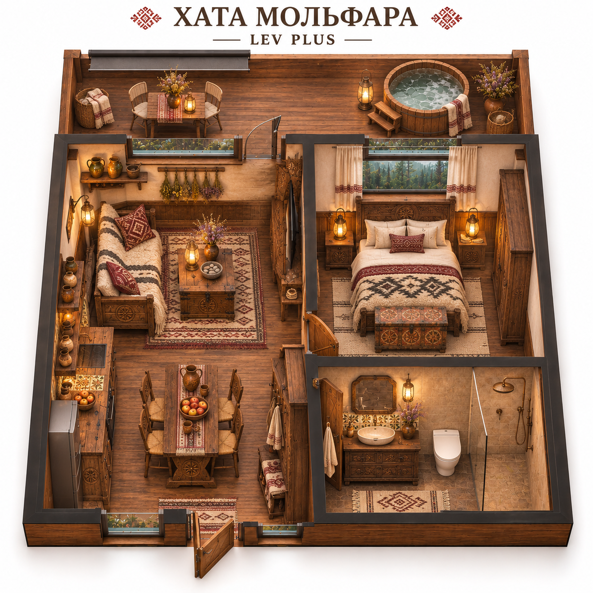
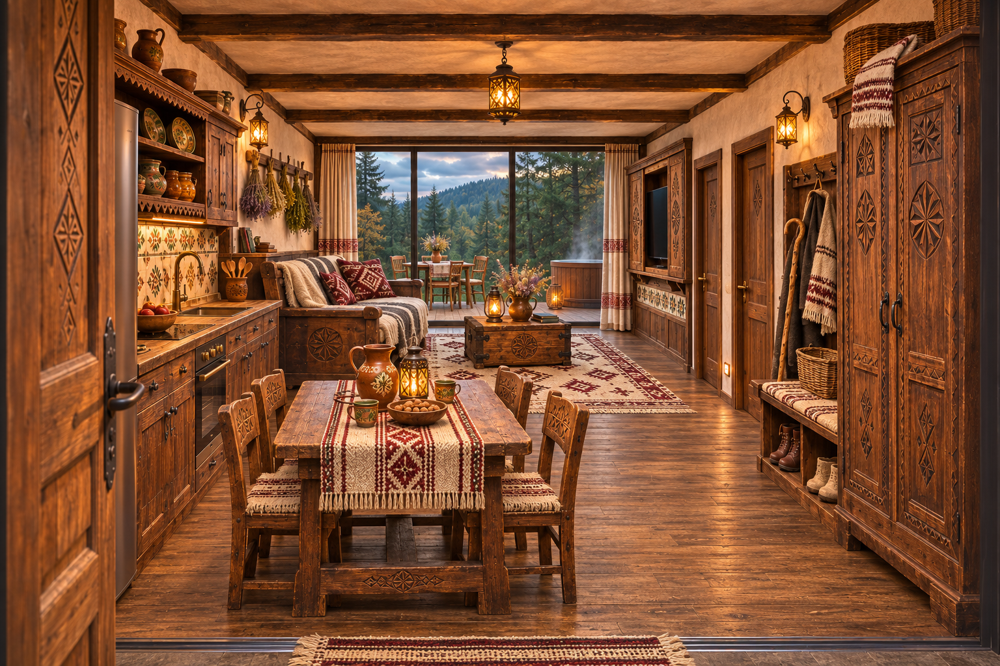
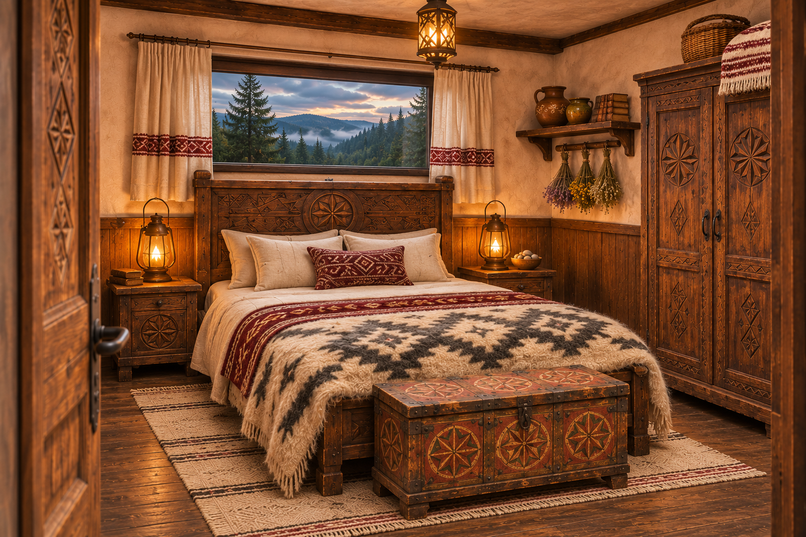
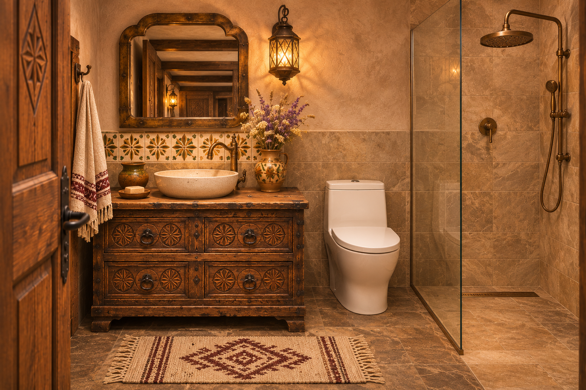

# Хата Мольфара

18.11.2026. Назву й напрям замовила Божена: сучасний будинок, у якому інтер’єр і старовинні меблі створюють відчуття давньої оселі карпатського мольфара. **Перша пропозиція для обговорення; художній дизайн ще не погоджено.** Номер серед чотирьох стилізацій другого типу не призначено.

## Чотири окремі ракурси

| № | Що показано | Файли |
|---|---|---|
| 1 | Загальний вигляд і планування | [Кадр](01-molfar-house-cutaway-v01.png) · [Запит](01-molfar-house-cutaway-v01-prompt.txt) |
| 2 | Студія від входу й двері приватних кімнат | [Кадр](02-molfar-studio-from-entry-v01.png) · [Запит](02-molfar-studio-from-entry-v01-prompt.txt) |
| 3 | Вхід у спальню та спальня | [Кадр](03-molfar-bedroom-from-door-v01.png) · [Запит](03-molfar-bedroom-from-door-v01-prompt.txt) |
| 4 | Вхід у санвузол і санвузол | [Кадр](04-molfar-bathroom-from-door-v01.png) · [Запит](04-molfar-bathroom-from-door-v01-prompt.txt) |

Загальна кімната — це одна спільна кухня-студія з обіднім столом і вітальнею, а не додаткова кімната. На кадрі 02 видно її від головного входу й двоє сусідніх дверей приватних кімнат; кадри 03–04 показують погляд крізь ці двері всередину спальні та санвузла.

## Планування

Збережено [останній одноповерховий варіант](../../concept/layout-variants/single-storey/entry-redesign/README.md): квадратний сучасний корпус із прямокутним панорамним склінням, кухня й студія ліворуч, закритий санвузол праворуч ближче до головного входу, одна закрита спальня праворуч далі. У кожної приватної кімнати власні двері зі студії. Тераса з протилежного боку, столик і чотири крісла ліворуч, купіль праворуч, якщо дивитися зсередини.

**Шафа вертикальна, фасадами до кухні та плити, спинкою до перегородки санвузла.** Гачки, низька банкетка й взуттєві ніші доступні зі студії; блок уздовж правої перегородки, а не поперек входу.

У загальному кадрі дах знято для огляду кімнат. Тип будинку й погоджені раніше концепції не перейменовували: «Хата Мольфара» — окрема стилізація. Геометрія, меблі й точні проходи ще потребують зведення на розмірному плані; це художні ракурси, не робочий проєкт. Дрібні пропорції та предмети між кадрами можуть відрізнятися.

## Атмосфера й меблі

Масивне дерево з патиною, різьблені розети й ромби, тепла світла штукатурка, декоративні темні балки. Палітра — димчасте дерево, вовняний молочний і графітовий, приглушений бордовий, вохра; зелений локально в кераміці.

- **Кухня й студія:** кухонні фасади під старі дерев’яні шафки та мисник; керамічний посуд на полицях, стіл із тканою доріжкою, чотири дерев’яні стільці. Побутова техніка й мийка залишаються сучасними.
- **Вітальня:** зручний дерев’яний диван-лава з вовняними покривалами й подушками, стара скриня як журнальний столик, тканий килим. TV у дерев’яному обрамленні з різьбленими розсувними стулками.
- **Деталі:** пучки сушених трав, глиняні глечики, кошики й світильники під старі ліхтарі. Це художні деталі атмосфери, не твердження про особливі властивості предметів.
- **Спальня:** дерев’яне ліжко з геометричним різьбленням, ліжник, лляна білизна, невеликі тумби та скриня.
- **Санвузол:** тумба у вигляді старої скрині, керамічна чаша, кахельний мотив, теплий кам’яний відтінок і ліхтарне світло. WC та скляна душова сучасні.

## Референси та генерація

Це авторська стилізація на основі карпатського й гуцульського побуту, а не точна реконструкція помешкання конкретного мольфара. До генерації виконано вебпошук зображень інтер’єрів і прочитано музейні описи:

- [Коломийський музей — експонати з дерева](https://ranok.kolomyya.org/museum/wood.htm): дерев’яні скрині, різьблені одвірки, сволоки, мисники та геометрична орнаментика.
- [Berea College, колекція LJAC — ліжник](https://ljacatc.berea.edu/pawtucket/index.php/Detail/objects/9233): вовняне карпатське покривало як референс фактури.
- [Музейний фонд України — скриня](https://museum.mincult.gov.ua/collections/skrinya): дерево, металевий замок і ручка як орієнтир матеріалів скрині.

Створено вбудованим ImageGen, кожен із чотирьох ракурсів окремим викликом. Повні запити наведено в таблиці. Для кадрів 01–02 локальними референсами геометрії були виправлений план і вхід «Лісової пісні»; їхнє оздоблення не переносили. Для кадрів 03–04 використано вже нові загальний вигляд і студію «Хати Мольфара». Вебфото не подавалися генератору як зображення.

Переглянуто всі чотири результати: розділення кімнат, видимість дверей, орієнтація шафи, характер меблів та наявність сантехніки. Моделі меблів, світильники, матеріали й комплектацію ще не обирали; окремий кошторис не складали.

## 1 — Загальний вигляд і планування

## 2 — Студія від входу й двері приватних кімнат

## 3 — Вхід у спальню та спальня

## 4 — Вхід у санвузол і санвузол

[До другого типу](../../README.md)

