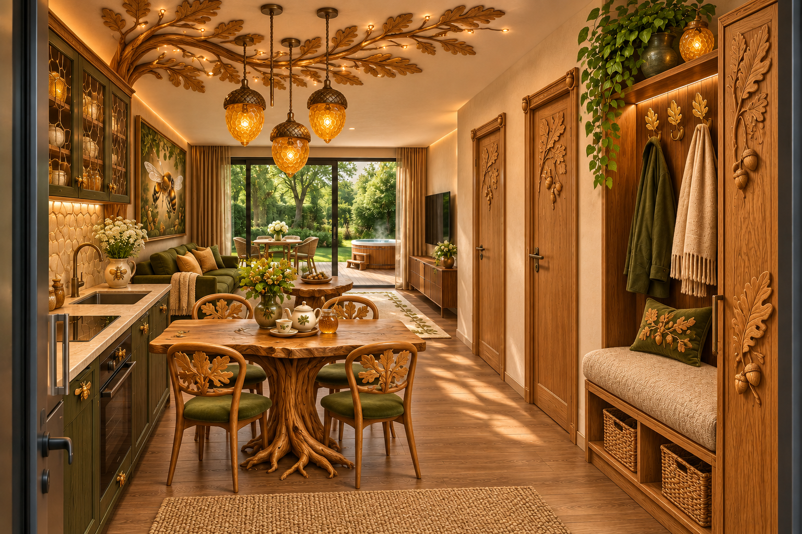

# «Бджілка і жолудь» — перша стилізація

**[Повний огляд: планування та 10 ракурсів будинку](walkthrough-v02/README.md)**, 22.11.2026: підхід і головний вхід, кухня-студія, вхід у санвузол і його інтер’єр, вхід у спальню та спальня зсередини, вигляд із дивана, вихід на терасу, накрита тераса й мангальна зона. Новий комплект для обговорення.

Дата: 22.11.2026. Назва й завдання задані Боженою. Художнє рішення — пропозиція для обговорення.

## Основа

За прямим уточненням користувачки квадратний корпус, планування й прорізи залишаються; змінюються меблі, оформлення, картини, столи й світло. Основа — [останній одноповерховий варіант другого типу](../../concept/layout-variants/single-storey/entry-redesign/README.md): кухня-студія, одна окрема закрита спальня, незалежний санвузол, тераса й зовнішня мангальна зона. Це окрема стилізація, попередні назви та варіанти не замінено.

## Художнє рішення

Сучасний казковий дубовий гай із медовими акцентами. Палітра: медовий дуб, лісовий зелений, теплий молочний, горіх, бурштин і латунь.

- Головний предмет — дерев’яний обідній стіл на чотирьох: стільниця з природним краєм, різьблена основа у вигляді дубового стовбура з корінням. Стіл зберігає звичайну обідню функцію.
- Крісла з дерев’яними спинками у формі переплетених гілок і листя, м’якими зеленими сидіннями.
- Світильники-жолуді з бурштинового скла; декоративне дубове листя на верхній частині стіни й під звичайною пласкою стелею.
- Лісова зелена кухня, керамічний фартух із мотивом стільників, маленькі латунні деталі-бджілки; техніка звичайна сучасна.
- Зелений диван, медовий текстиль, дерев’яний журнальний столик і ботанічна картина з бджілкою, листям та жолудями.
- Спальня: дерев’яне узголів’я з дубовим листям, молочний текстиль із медовими акцентами. Санвузол: зелена кераміка, дерево й бурштинове світло. Окремі ракурси кімнат — у повному огляді вище.

## Що дав пошук

Конкретну опубліковану казку саме під назвою «Бджілка і жолудь» у виконаному пошуку не підтверджено. Авторство, сюжет і персонажі не приписуються жодному твору; запропонована атмосфера є авторською інтерпретацією назви. Якщо користувачка уточнить твір, мотиви можна скоригувати.

- [The Trunk House — Paul Morgan Architects](https://www.paulmorganarchitects.com/residential-architecture/the-trunk-house): природні розгалуження дерева та виразна фактура деревини. Для нашого будинку це натхнення меблями й декором, а не зміна конструкції.
- [Løvtag — The cabins](https://www.lovtag.dk/en/the-cabins/): сучасний комфорт поруч із деревом і великим склінням. Живе дерево крізь дах і розташування на висоті не переносимо в наш квадратний корпус.

Вебфото не передавалися генератору як зображення. Локальний референс студії — наявний кадр від входу; він задає архітектуру та ракурс.

## Візуалізація

[Студія від входу — перший варіант](01-studio-entry-v01.png) · [Повний запит](01-studio-entry-v01-prompt.txt).

На кадрі збережено кухню ліворуч, зберігання біля входу праворуч, двоє окремих дверей праворуч і прямокутне скління на терасу. Точні проходи та виготовлення столу з коренеподібною основою потребують перевірки після вибору оформлення.

**Уточнення тераси від 22.11.2026:** один суцільний дашок над усією терасою, відкритий передній край без перегородки; мангал збоку й добре видимий. Це має пріоритет над відкритою терасою першої студії та помилковим частковим накриттям на першому загальному плані. Поточний план v03 — у повному огляді вище.

**Останні уточнення того ж дня:** стіл тераси круглий на схемі та фото; у спальні два невеликі килимки замість великого; шафа коричнева дерев’яна, також крізь вікно на зовнішньому ракурсі. Поточна схема розміщення — векторна **v04**, попередній художній план v03 збережено як історію. Усі останні ракурси та повні запити — у повному огляді.

Створено вбудованим ImageGen. Повний запит зберігається поруч із кадром. Візуал є ескізом оформлення; він не визначає розміри, конструкцію меблів, монтаж декору або кошторис.

[До другого типу](../../README.md)
