# «Бджілка і жолудь» — план і повний огляд будинку

Дата: 22.11.2026. Комплект за запитом Божени. Статус — візуальна пропозиція для обговорення.

## Поточні вимоги

Квадратний одноповерховий корпус. Кухня-студія ліворуч, одна закрита спальня праворуч далі від головного входу, душова з туалетом праворуч біля входу. У спальню й санвузол — незалежні входи зі студії. Передній вхід із двору та вихід на терасу — різні.

- **Вся тераса під одним суцільним дашком**, відкритий передній край і боки, без перегородки, огорожі чи скління. Тонкі опори залишаються.
- **Стіл на терасі круглий**, на чотирьох, дерев’яний; форма має збігатися на плані й ракурсах. Внутрішній стіл-дуб — окремий предмет з органічною стільницею.
- **Мангал збоку й видимий із тераси**, на окремому мощеному майданчику під власним відкритим навісом.
- **У спальні два невеликі приліжкові килимки** замість великого під ліжком. Запропоновано два оливкові дубові листки з молочною жилкою й медовим краєм, орієнтовно 60 × 90 см кожен.
- **Шафа спальні коричнева дерев’яна**, з дубовим різьбленням; біла шафа на попередньому зовнішньому кадрі була невідповідністю.

Зсередини при погляді назовні обіднє місце тераси ліворуч, купіль праворуч, мангал далі ліворуч. Із саду при погляді на будинок сторони дзеркально міняються.

Божена зазначила, що початкове розміщення їй не подобається. Для цього комплекту запропоновано компактніший внутрішній стіл і вільніший прохід до тераси; новий поділ перегородок ще не затверджений.

## 01 — Схема зверху

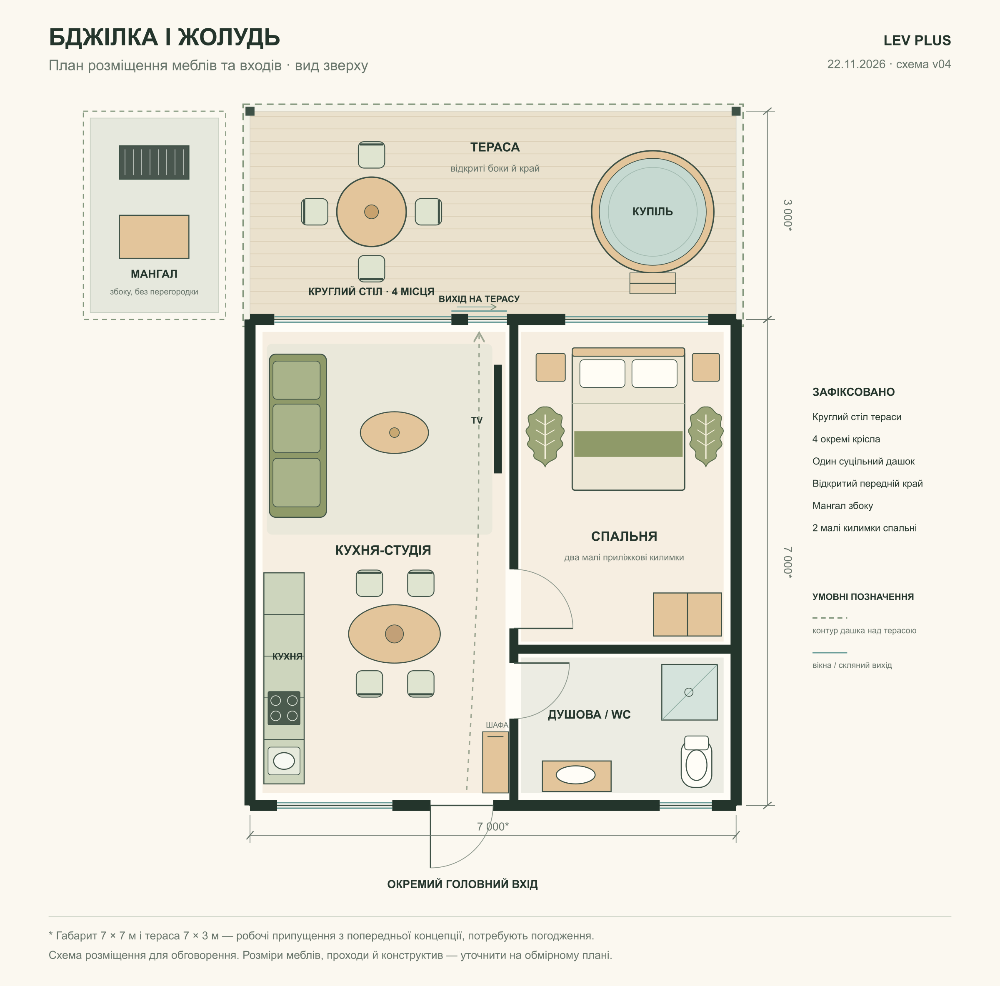

[PNG](00-layout-technical-v04.png) · [Редагований SVG](00-layout-technical-v04.svg) · [Джерело побудови](draw-layout-v04.cjs).

Схема побудована векторно: круглий стіл, дверні прорізи, дуги відкривання, меблі й два килимки задаються явно. Пунктир навколо тераси — контур дашка **над** настилом, а не огорожа. Габарити корпусу 7 × 7 м і тераси 7 × 3 м узято лише як попередні припущення зі старішої концепції; це не обмір і не погоджене робоче креслення. Розміри меблів, проходи й конструктив ще треба перевірити.

## Усі ракурси

| № | Ракурс | Картинка | Запит / джерело |
|---|---|---|---|
| 01 | Чітка схема розміщення зверху | [Відкрити](00-layout-technical-v04.png) | [SVG](00-layout-technical-v04.svg) |
| 02 | Підхід і окремий головний вхід | [Відкрити](02-front-entrance.png) | [Запит](02-front-entrance-prompt.txt) |
| 03 | Вхід у кухню-студію | [Відкрити](03-studio-from-entry.png) | [Запит](03-studio-from-entry-prompt.txt) |
| 04 | Як заходимо в санвузол | [Відкрити](04-bathroom-entrance.png) | [Запит](04-bathroom-entrance-prompt.txt) |
| 05 | Санвузол зсередини | [Відкрити](05-bathroom-interior.png) | [Запит](05-bathroom-interior-prompt.txt) |
| 06 | Вхід у спальню — без великого килима | [Відкрити](06-bedroom-entrance-small-rugs-v02.png) | [Запит](06-bedroom-entrance-small-rugs-v02-prompt.txt) |
| 07 | Спальня — два маленькі килимки | [Відкрити](07-bedroom-two-small-rugs-v02.png) | [Запит](07-bedroom-two-small-rugs-v02-prompt.txt) |
| 08 | Що бачимо з дивана | [Відкрити](08-view-from-sofa-round-table-v02.png) | [Запит](08-view-from-sofa-round-table-v02-prompt.txt) |
| 09 | Вихід зі студії на терасу — круглий стіл | [Відкрити](09-terrace-exit-round-table-v02.png) | [Запит](09-terrace-exit-round-table-v02-prompt.txt) |
| 10 | Уся тераса — коричнева шафа у спальні | [Відкрити](10-covered-terrace-brown-wardrobe-v03.png) | [Запит](10-covered-terrace-brown-wardrobe-v03-prompt.txt) |
| 11 | Мангальна зона з тераси | [Відкрити](11-bbq-area.png) | [Запит](11-bbq-area-prompt.txt) |

## 02 — Підхід і окремий головний вхід

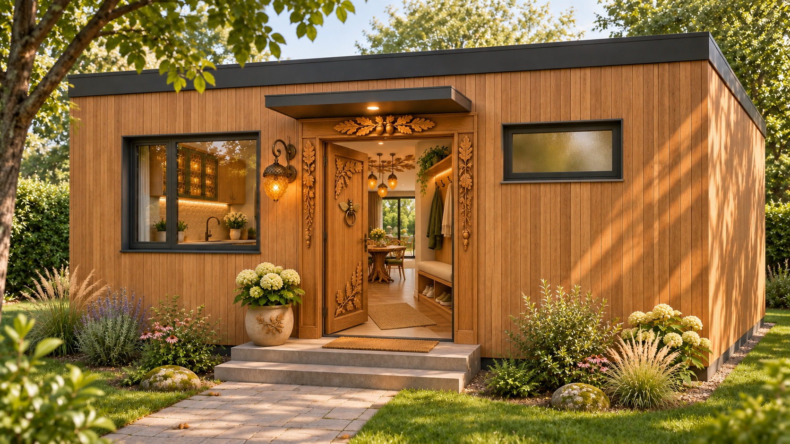

## 03 — Вхід у кухню-студію

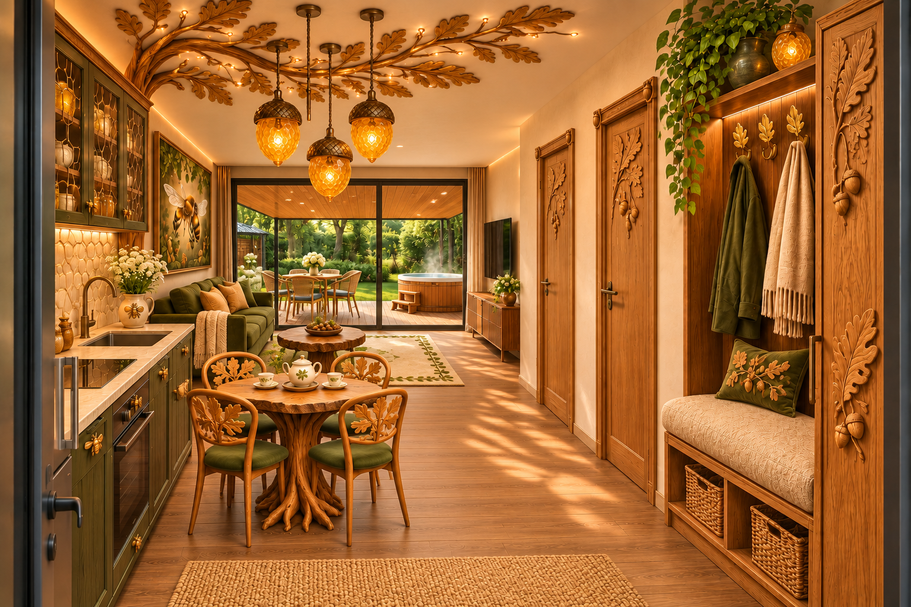

## 04 — Як заходимо в санвузол

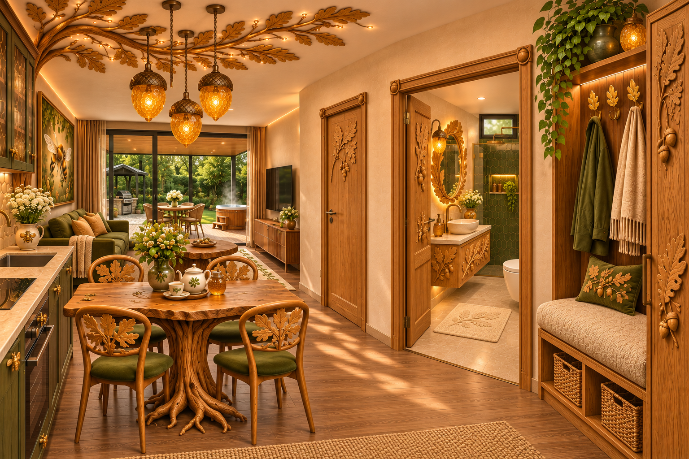

## 05 — Санвузол зсередини

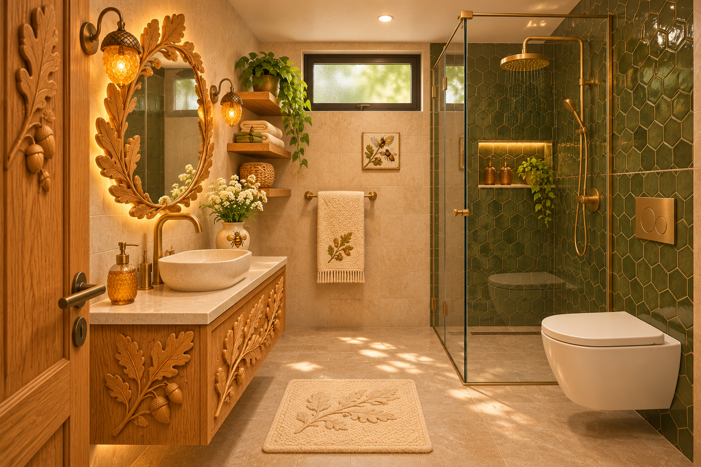

## 06 — Вхід у спальню — без великого килима

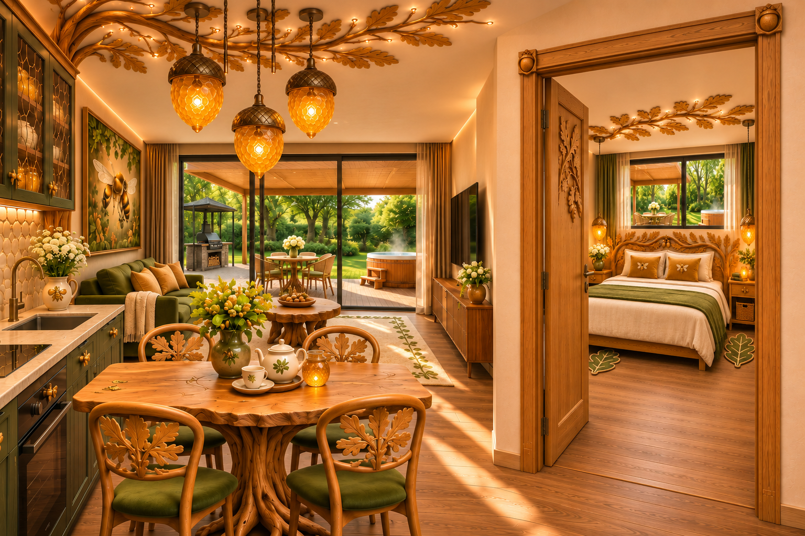

## 07 — Спальня — два маленькі килимки

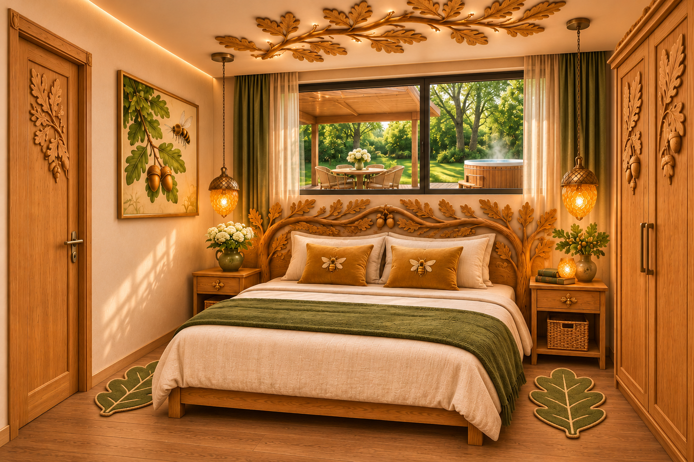

## 08 — Що бачимо з дивана

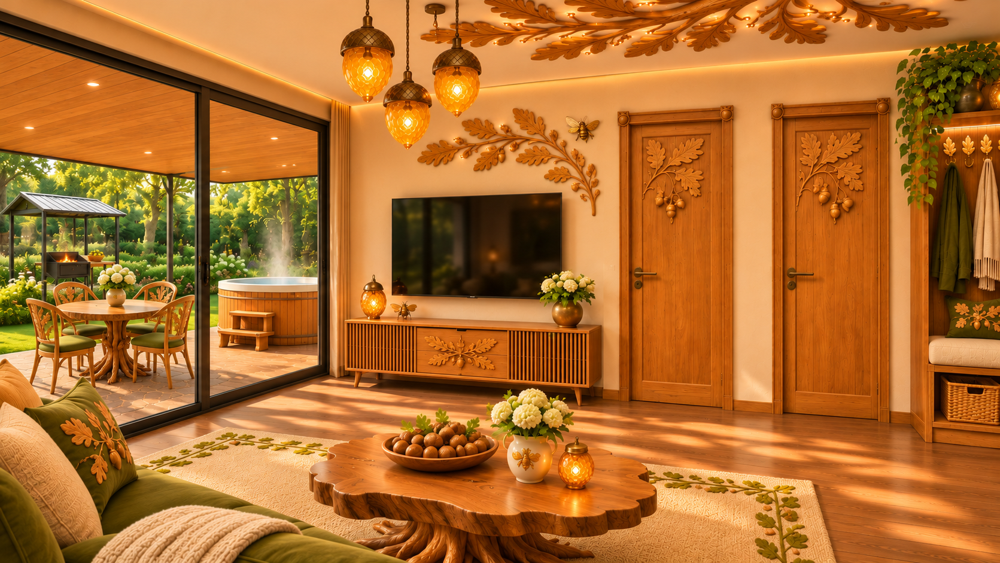

## 09 — Вихід зі студії на терасу — круглий стіл

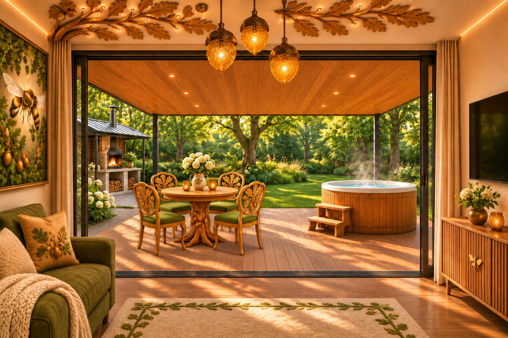

## 10 — Уся тераса — коричнева шафа у спальні

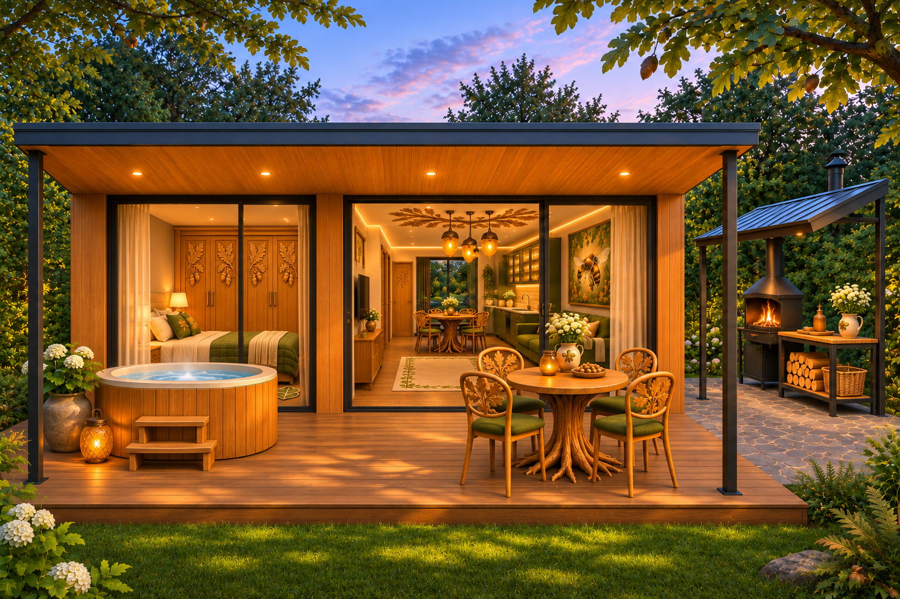

## 11 — Мангальна зона з тераси

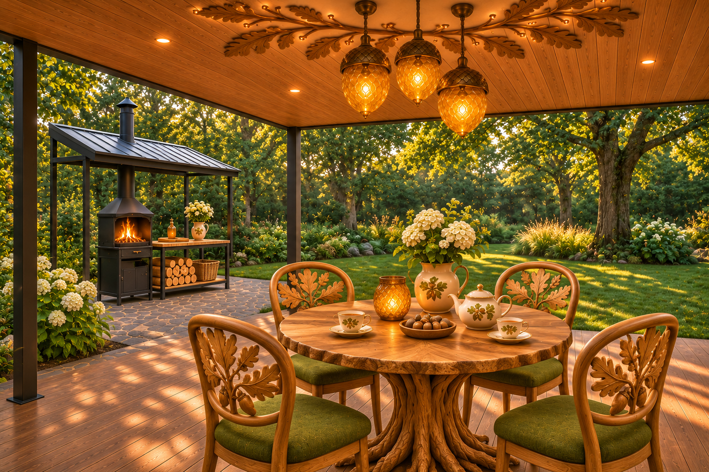

## Добір килимків

Під час вебпошуку переглянуто [Lorena Canals Mini Monstera Olive](https://lorenacanals.com/fr/products/washable-rug-mini-monstera-olive?variant=46736224026961): малий килимок-листок в оливковому й натуральному кольорах, 75 × 100 см. Це референс природної форми та палітри. Для нашого інтер’єру запропоновано авторські дубові силуети меншого розміру; конкретного готового товару з таким дубовим малюнком не обрано. Показані килимки не є точною копією цієї моделі.

## Збережені попередні варіанти

[Перший художній план](01-full-layout.png), [план із виправленим суцільним дашком v03](01-full-layout-roof-v03.png), [спальня з великим килимом](07-bedroom-interior.png), [попередня тераса з білою шафою](10-covered-terrace.png) — історія пошуку. Поточні схема й ракурси наведені вище.

## Спосіб створення й межі

Фото створено та відредаговано вбудованим ImageGen із локальними референсами; повні запити збережені поруч. Схему зверху побудовано окремо як SVG та виведено в PNG. Перелік поточних матеріалів — [у маніфесті](generation-manifest.json).

Це концепція оформлення та схема розміщення, а не будівельний робочий проєкт. Фото показують матеріали й сценарії, але не підтверджують точних розмірів; дрібні деталі й пропорції між ними можуть відрізнятися. Новий кошторис не складали.

[До стилізації «Бджілка і жолудь»](../README.md)
