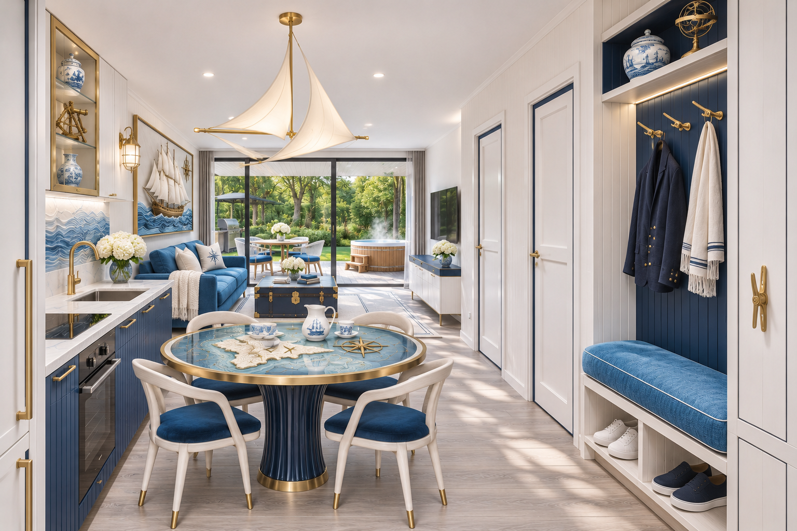

# «Будинок скарбів» — перша концепція

**Увесь комплект збережено до вибору й перегляду 23.11.2026.** У папці — головний ескіз, усі 11 ракурсів, зовнішня накрита тераса, мангал, нічний вигляд і повні запити ImageGen. Остаточний дизайн обираємо після спільного обговорення.

Дата: 22.11.2026. Окрема стилізація другого типу за запитом Божени. Назва будинку — «Будинок скарбів»; сюжетний орієнтир — мультфільм «Острів скарбів». Дизайн для обговорення.

**[Повний огляд — 11 ракурсів «Будинку скарбів»](walkthrough-v01/README.md):** вхід, передпокій, кухня-студія, погляд із дивана, ванна кімната, спальня, зовнішній вигляд усієї накритої тераси, мангал і нічний кадр.

[Відкрити зображення](01-treasure-house-blue-white-studio-v01.png) · [Повний запит ImageGen](01-treasure-house-blue-white-studio-v01-prompt.txt).

## Завдання та основа

Божена попросила одразу виразний, дорогий на вигляд інтер’єр із сильним казковим характером. Вона окремо уточнила: палітра має відрізнятися від «Гуцуланду»; орієнтир — блакитний і білий, підбір теми й деталей доручено асистенту.

Збережено той самий квадратний одноповерховий корпус і логіку входів: кухня ліворуч, зберігання при вході праворуч, студія, одна закрита спальня та окремий санвузол за правою перегородкою, вихід на терасу попереду. Нейтральний попередній кадр від входу задає лише архітектуру й камеру. Кольори й декор розроблено заново.

Тераса під одним суцільним дашком, відкритий передній край і боки; круглий стіл на чотирьох ліворуч, купіль праворуч, мангал збоку на окремому мощеному майданчику. За склом залишається лісовий сад: морська тема — художня інтерпретація інтер’єру.

## Художній напрям

Перлинно-білий, небесно-морський блакитний, глибокий синій, світле сріблясте дерево й матова латунь. Мотиви пригоди — карта острова, вітрильник «Гіспаньйола», компас і капітанська скриня.

- Головний предмет — компактний капітанський обідній стіл на чотирьох із оригінальною картою під рівною скляною вставкою; морські контури, роза вітрів і маршрут виконані як тонка інкрустація.
- Скульптурний білий світильник-вітрило на тонкій латунній основі.
- Блакитний диван, молочний текстиль, велике об’ємне панно з білими вітрилами на синіх хвилях.
- Журнальний столик-скриня із синім оздобленням і латунними деталями, придатний для звичайного користування.
- Біла й синя кухня, світлий камінь, локальна кераміка з хвилястим рельєфом; сучасна робоча техніка.
- Зберігання, двері та меблі продовжують біло-синю палітру. Тема не повторює гуцульську геометрію чи кольорову схему попереднього будинку.

## Дослідження теми

- [Держкіно — «Острів скарбів»](https://www.usfa.gov.ua/movie-catalog/ostriv-skarbiv-i9634): анімаційна екранізація Давида Черкаського, студія «Київнаукфільм»; сюжетні мотиви пошуку скарбів капітана Флінта.
- [Довженко-Центр — Treasure Island / Ostriv skarbiv](https://dovzhenkocentre.org/en/top-100/treasure-island-ostriv-skarbiv/): опис мультфільму, пригодницький характер і портово-морський світ. Опис прочитано через пошукову видачу; пряме відкриття української сторінки повертало помилку.
- [SINOT — Inspire](https://sinot.com/inspire/): джерело натхнення морським середовищем, природним світлом і деталями сучасної яхти. Масштаб і конструкція яхти не переносяться на наш будинок.
- [Bannenberg & Rowell — Blue Bird](https://www.bannenbergandrowell.com/projects/interiors/blue-bird/): сучасне переосмислення історичних морських інтер’єрів як орієнтир якості деталей.

Блакитно-біла палітра й оформлення — авторська пропозиція за побажанням користувачки, а не твердження про точні кольори мультфільму. Панно й карта оригінальні, без копіювання конкретного кадру чи проєкту яхти. Вебфото не передавалися генератору.

Створено вбудованим ImageGen. Повний запит збережено поруч. Цей кадр став основою повного огляду за посиланням угорі. Площі, конструктив, виготовлення меблів і кошторис не визначаються цими зображеннями.

[До другого типу будинків](../../README.md)
