# «Будинок скарбів» — повний огляд

Дата: 22.11.2026. Комплект за запитом Божени: усі звичні ракурси будинку, з окремим зовнішнім виглядом тераси. Статус — візуальні пропозиції для обговорення.

## Єдина основа

Основний кадр — [блакитно-біла студія](../01-treasure-house-blue-white-studio-v01.png). Перлинно-білий, морський блакитний, глибокий синій, світла підлога та латунь; карта під склом круглого капітанського столу, світильник-вітрило, панно з «Гіспаньйолою» та закрита скриня-столик.

Квадратний одноповерховий корпус. Головний вхід із двору, праворуч зберігання й блакитне сидіння, ліворуч кухня, далі студія з виходом на терасу. Праворуч — незалежні двері ванної кімнати ближче до входу та спальні далі до TV. Із дивана прямо видно TV, збоку — вихід на терасу.

Спальня продовжує біло-синю палітру: блакитне узголів’я, молочна постіль, синій текстиль, біло-синя шафа й два невеликі приліжкові килимки. Ванна кімната — душ за склом, туалет, тумба з умивальником, кругле латунне дзеркало й біло-блакитні керамічні хвилі.

**Тераса накрита одним суцільним дашком по всій ширині та глибині.** Передній край і боки відкриті, без перегородок, скління чи огорожі. Круглий стіл і чотири біло-блакитні крісла; купіль збоку; мангал на сусідньому мощеному майданчику під власним відкритим навісом. При погляді зсередини назовні стіл ліворуч, купіль праворуч, мангал далі ліворуч; із саду при погляді на будинок — дзеркально. У кадрі 10 з-за столу дивимося в бік мангала; купіль лишається позаду камери. За вікнами — лісовий сад, морська тема живе в інтер’єрі.

## Усі ракурси

| № | Ракурс | Зображення | Повний запит |
|---|---|---|---|
| 01 | Головний вхід із двору | [Відкрити](01-front-entrance.png) | [Запит](01-front-entrance-prompt.txt) |
| 02 | Передпокій і блакитне сидіння | [Відкрити](02-entry-storage.png) | [Запит](02-entry-storage-prompt.txt) |
| 03 | Кухня-студія від входу | [Відкрити](03-studio-from-entry.png) | [Запит](../01-treasure-house-blue-white-studio-v01-prompt.txt) |
| 04 | Що видно з дивана | [Відкрити](04-sofa-to-tv.png) | [Запит](04-sofa-to-tv-prompt.txt) |
| 05 | Вхід у ванну кімнату | [Відкрити](05-bathroom-door.png) | [Запит](05-bathroom-door-prompt.txt) |
| 06 | Ванна кімната | [Відкрити](06-bathroom-interior.png) | [Запит](06-bathroom-interior-prompt.txt) |
| 07 | Вхід у спальню | [Відкрити](07-bedroom-door.png) | [Запит](07-bedroom-door-prompt.txt) |
| 08 | Спальня | [Відкрити](08-bedroom-interior.png) | [Запит](08-bedroom-interior-prompt.txt) |
| 09 | Зовнішній вигляд накритої тераси | [Відкрити](09-covered-terrace.png) | [Запит](09-covered-terrace-prompt.txt) |
| 10 | З тераси на мангал | [Відкрити](10-bbq-from-terrace.png) | [Запит](10-bbq-from-terrace-prompt.txt) |
| 11 | Нічний вигляд із тераси | [Відкрити](11-night-from-terrace.png) | [Запит](11-night-from-terrace-prompt.txt) |

## 01 — Головний вхід із двору

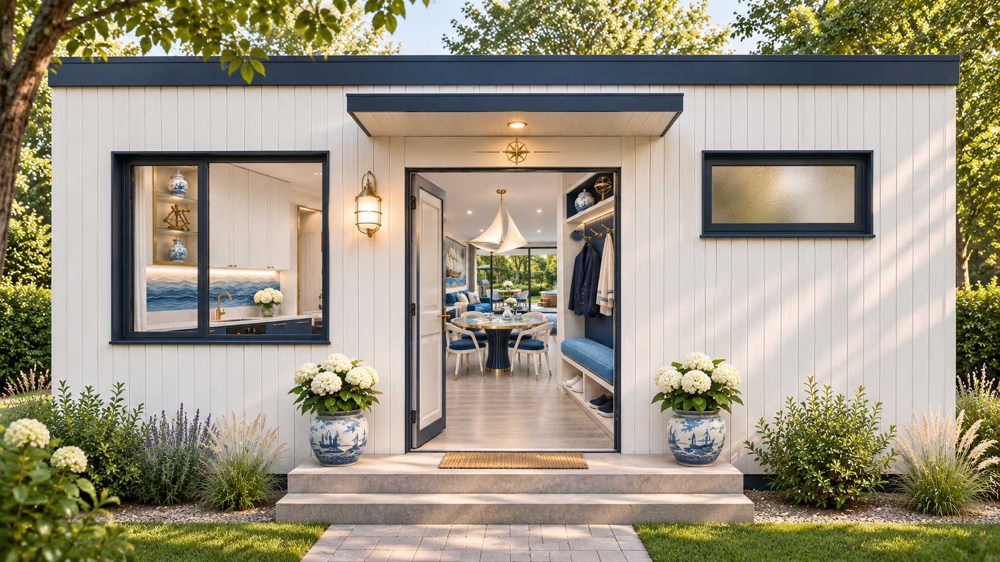

## 02 — Передпокій і блакитне сидіння

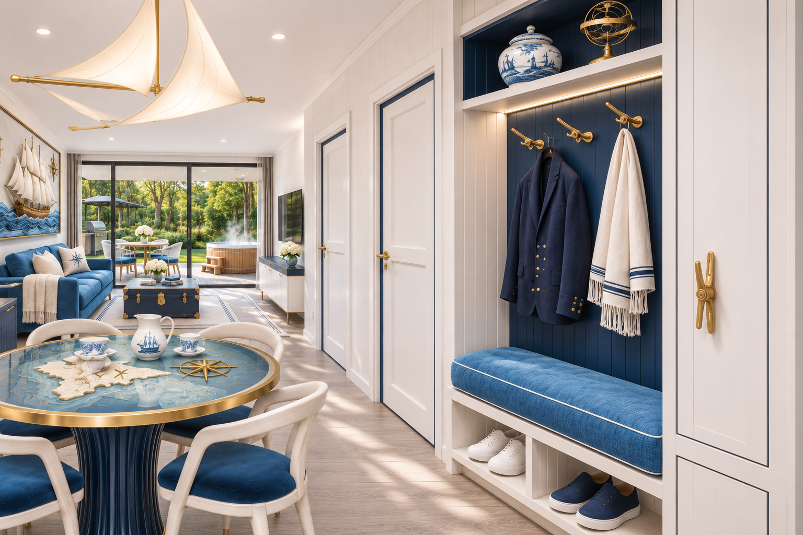

## 03 — Кухня-студія від входу

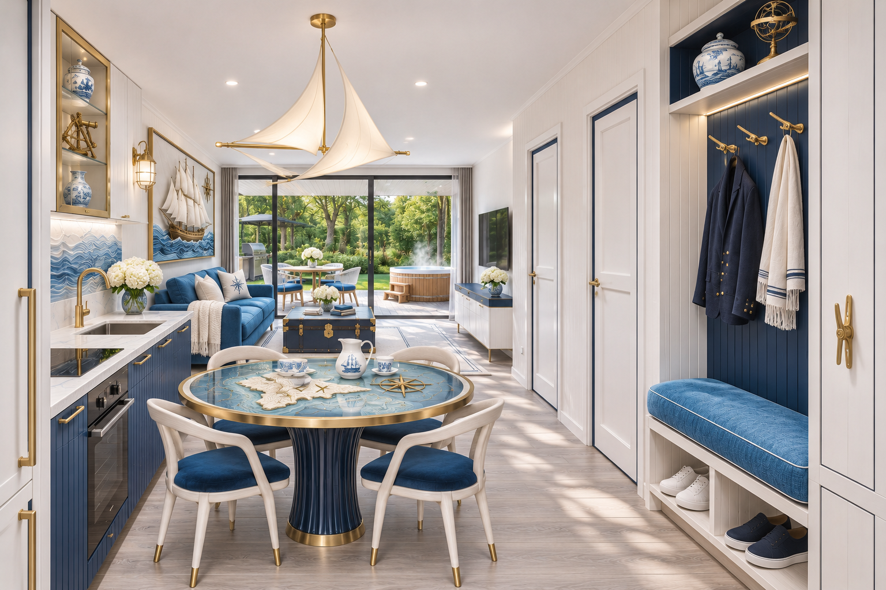

## 04 — Що видно з дивана

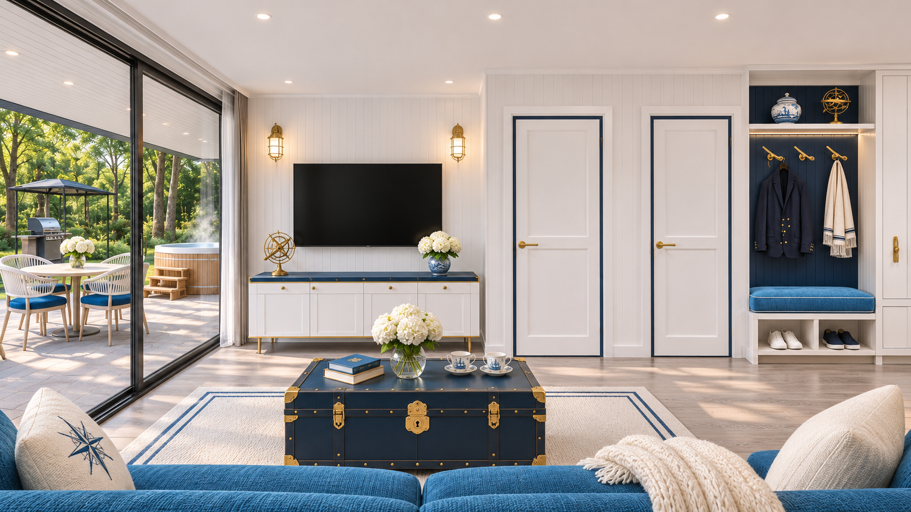

## 05 — Вхід у ванну кімнату

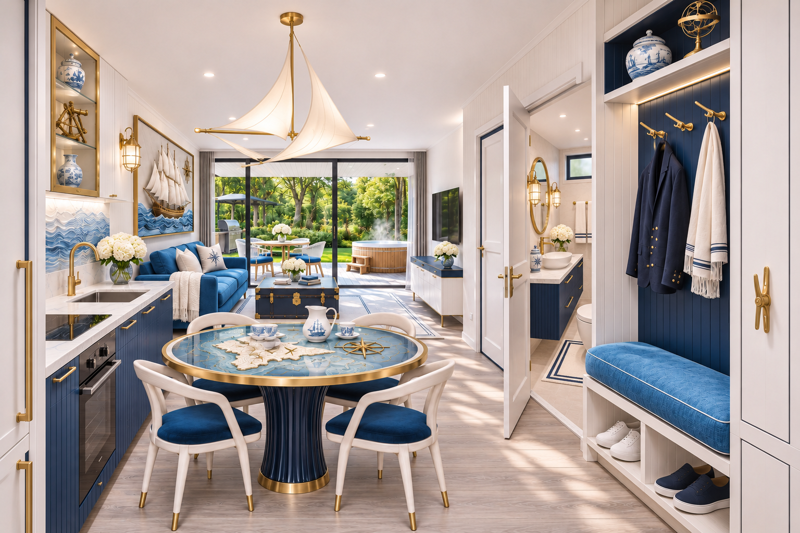

## 06 — Ванна кімната

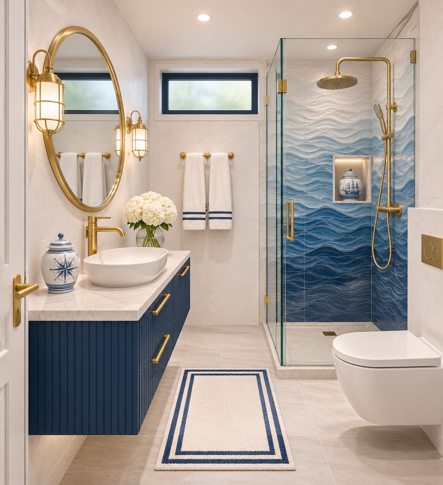

## 07 — Вхід у спальню

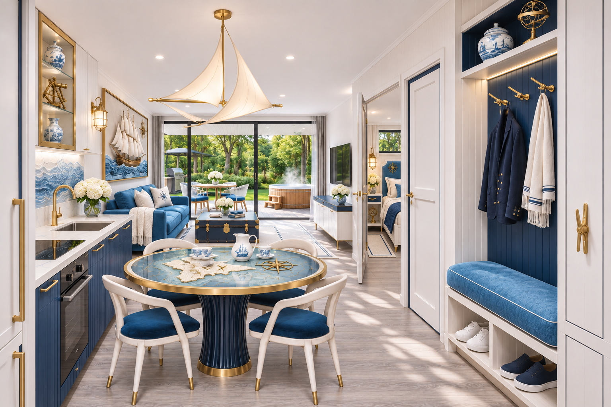

## 08 — Спальня

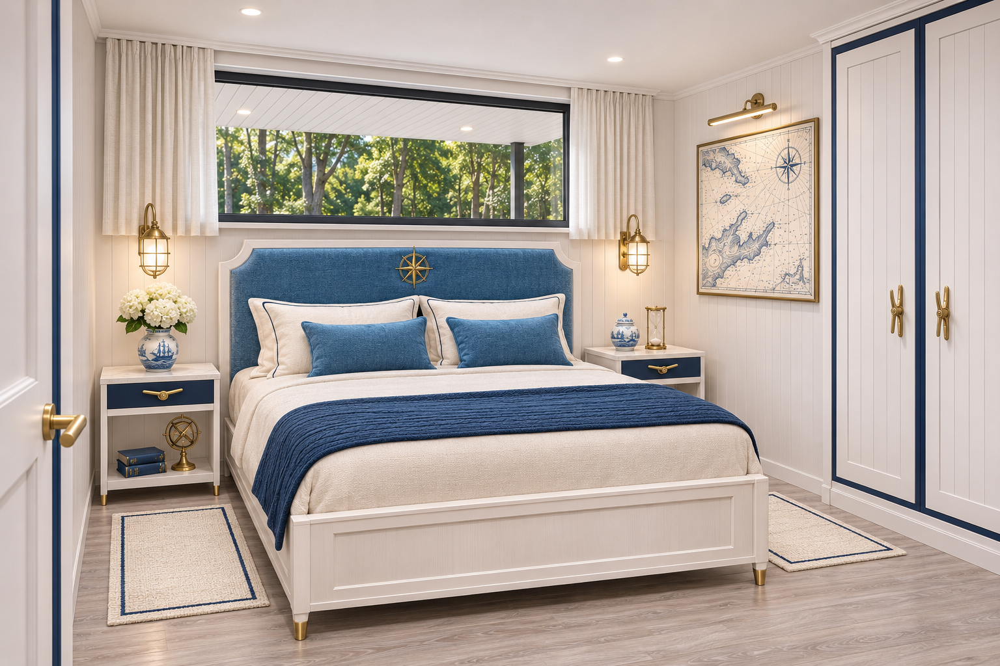

## 09 — Зовнішній вигляд накритої тераси

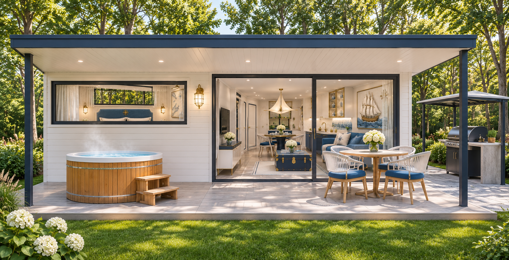

## 10 — З тераси на мангал

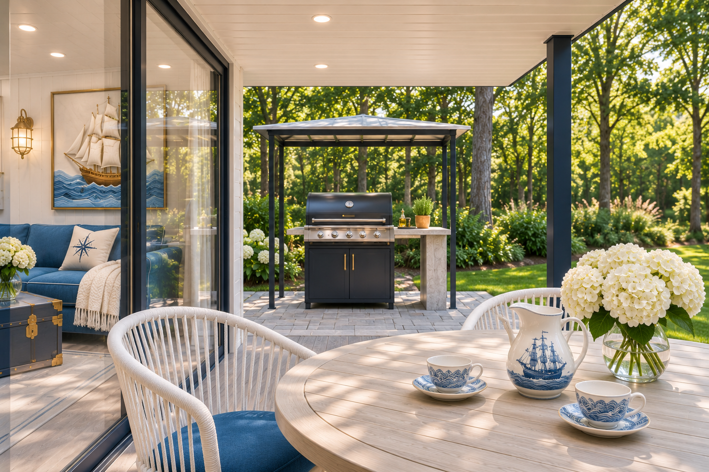

## 11 — Нічний вигляд із тераси

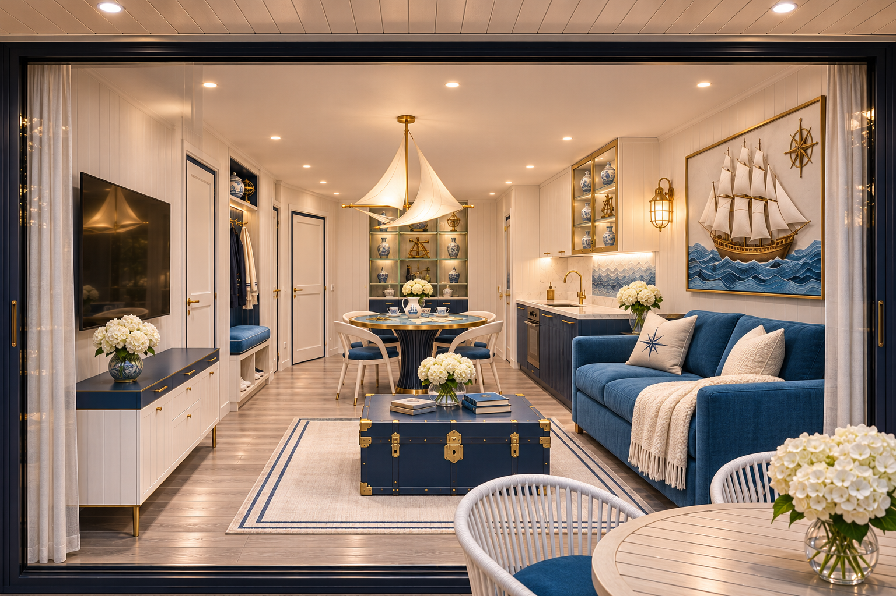

## Створення та статус

Вбудований ImageGen, окремий виклик для кожного нового ракурсу. Кадр 03 — копія основної студії. Для всіх зображень основою є власний перший кадр «Будинку скарбів»; входи до приватних кімнат звірено з новими інтер’єрами цих кімнат, терасу — зі спальнею, мангальний і нічний ракурси — із загальним видом тераси. Повні запити збережені поруч; [перелік поточних файлів і референсів](generation-manifest.json).

Зображення концептуальні: показують оформлення й сценарії, а не точний обмір або робочий проєкт. Дрібні пропорції й декор між генеративними кадрами можуть відрізнятися. Площі, меблеві розміри, проходи, конструкція накриття й обладнання потребують окремого опрацювання. Новий кошторис не складався.

[До концепції «Будинку скарбів»](../README.md)
