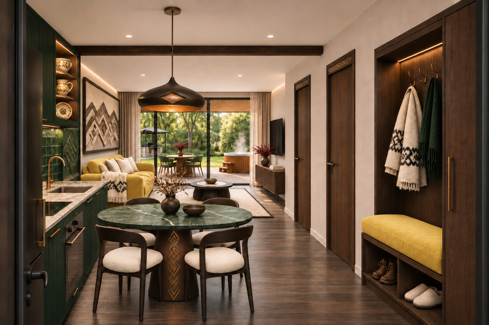
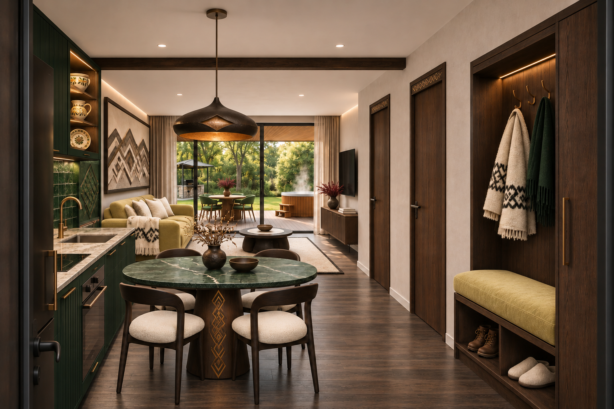
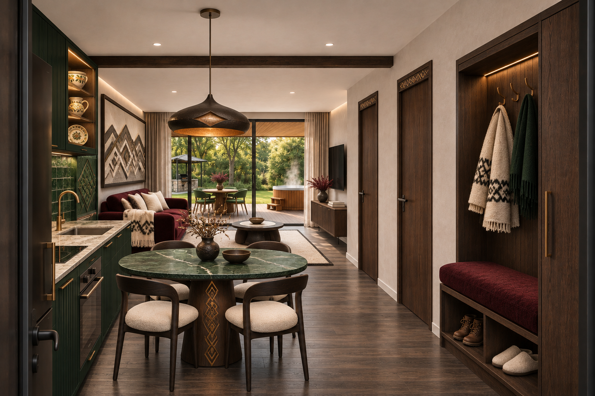
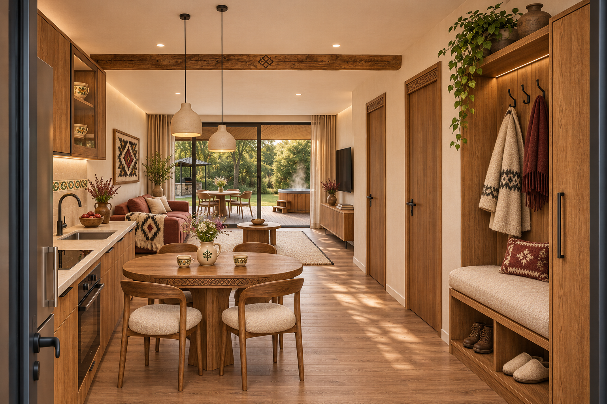

# «Гуцуланд» — усі ескізи та варіанти

**Збережено для обговорення з Тарасом 23.11.2026.** У цій папці всі попередні кольорові варіанти, поточні 11 ракурсів, нічний вигляд, проміжні ескізи та повні запити ImageGen. На зустрічі визначаємо, які рішення залишаємо й що можна реалізувати; фінальний комплект ще не затверджений.

Дата: 22.11.2026. Окрема стилізація другого типу за запитом Божени. Назву й напрям задано користувачкою, конкретний дизайн ще для обговорення.

**[Повний огляд «Гуцулленду» — 11 ракурсів за палітрою v04](walkthrough-v04/README.md):** головний вхід і передпокій, студія, вигляд із дивана, входи та інтер’єри ванної кімнати й спальні, вся накрита тераса, мангал і нічний погляд із тераси всередину. Нові кімнати — пропозиції для обговорення.

## Варіант 04 — жовтий трохи яскравіший

[Відкрити зображення v04](04-hutsulland-warmer-yellow-v04.png) · [Повний запит ImageGen v04](04-hutsulland-warmer-yellow-v04-prompt.txt).

На наступне прохання Божени жовтий на дивані та сидінні біля шафи трохи підсилено: тепліший золотисто-жовтий, зі збереженням м’якого характеру. Інші матеріали, меблі, світло та планування залишаються основою v03. Виконано вбудованим ImageGen за кадром v03; попередній відтінок збережено нижче для порівняння. Остаточне погодження кольору ще попереду.

## Варіант 03 — приглушений жовтий диван і сидіння

[Відкрити зображення v03](03-hutsulland-muted-yellow-v03.png) · [Повний запит ImageGen v03](03-hutsulland-muted-yellow-v03-prompt.txt).

Божена оцінила v02 як кращий напрям і попросила спробувати інший колір дивана й м’якої подушки-сидіння біля шафи: приглушений жовтий. Для проби запропоновано м’який солом’яно-жовтий відтінок. Змінюються тільки оббивка дивана та довге сидіння при вході; смарагдова кухня, кам’яний стіл, темне дерево, бронза, молочні подушки та ліжник залишаються основою v02. Остаточний вибір між вишневим і жовтим ще не зроблено.

Редагування виконано вбудованим ImageGen за власним кадром v02, збереженим нижче для порівняння.

## Варіант 02 — смарагд і вишня

[Відкрити зображення v02](02-hutsulland-emerald-cherry-v02.png) · [Повний запит ImageGen v02](02-hutsulland-emerald-cherry-v02-prompt.txt).

Після першого кадру Божена попросила виразніший дорогий вигляд, іншу палітру та помітну родзинку. Коричнево-бежева гама й простота першого варіанта їй не підійшли. Збережено побажання про помірну кількість ефектів і декору.

Запропонований напрям v02: глибокий смарагд, вишневий оксамит, темний дуб і стримана бронза. Матеріальні акценти — глазурована кераміка, зелений камінь з тонкими світлими прожилками, вовна й скульптурний керамічний світильник. Гуцульську геометрію перенесено у велике рельєфне панно та дрібні деталі інкрустації. Це нова пропозиція, ще не погоджений вибір матеріалів чи меблів.

### Що дав повторний пошук

- [YOD — Mountain Residence, лобі](https://www.yod.group/projects/design-project-lobby-mountine-residence-hotel): локальні ремесла й природні матеріали подано як виразні художні об’єкти. Для нашої невеликої студії цей прийом адаптовано у масштабі панно й одного світильника; готельне планування не переноситься.
- [YOD — 88 Vinotheque, HAY Boutique Hotel and SPA](https://www.yod.group/projects/design-project-restaurant-88-vinotheque-hay-boutique-hotel-and-spa-by-edem-family): робота з ремеслом і локальними матеріалами як сучасною інтерпретацією місця.
- [MAKHNO — SVITLO Apartment](https://makhnostudio.com/project/svitlo-apartment/): скульптурна кераміка й характер освітлення як орієнтир для авторського акценту. Конкретну модель світильника не копіювали й не обирали для закупівлі.

Варіант v02 створено вбудованим ImageGen. Єдиний переданий зображенням референс — власний v01 для геометрії та ракурсу; вебфото не передавалися генератору. Планування, двоє окремих дверей, зберігання при вході й повне накриття тераси залишаються основою.

## Варіант 01 — збережений попередній напрям

[Зображення v01](01-hutsulland-studio-v01.png) · [Повний запит v01](01-hutsulland-studio-v01-prompt.txt).

## Завдання

Сучасний будинок із виразним гуцульським характером, помірним декором і спокійним світлом. Користувачка зазначила, що «Бджілка і жолудь» їй не дуже подобається; попередній комплект збережено в його папці.

Планування залишається основою: квадратний одноповерховий корпус, кухня-студія, одна закрита спальня та незалежний санвузол. Кухня ліворуч, зберігання праворуч при вході, окремі двері приватних кімнат праворуч, вихід на терасу попереду. Тераса під одним суцільним дашком, передній край і боки відкриті; круглий стіл на чотирьох, купіль збоку, мангал на сусідньому мощеному майданчику.

## Художній напрям

Теплий коричневий дуб, молочна мінеральна штукатурка, вовна, льон і приглушений теракотовий. Локальні акценти — геометрична гуцульська різьба, один тканий настінний акцент, ліжник і кілька косівських керамічних виробів. Меблі звичайного дорослого масштабу, вільний прохід до тераси; основні поверхні спокійні.

Перший ракурс — кухня-студія від входу. Це пропозиція художнього напряму, не підтвердження робочих розмірів або бюджету.

На першому кадрі — коричнева дерев’яна кухня, компактний овальний стіл на чотирьох із вузькою геометричною різьбою, теракотовий диван, вовняний текстиль, невелике ткане панно й локальна косівська кераміка. Двоє незалежних дверей праворуч і прохід до тераси залишаються читабельними; зберігання при вході звернене до кімнати. У v01 був лише цей ракурс; повний огляд за новішою палітрою v04 доступний за посиланням угорі.

## Джерела натхнення

- [Коломийський музей — експонати з дерева](https://ranok.kolomyya.org/museum/wood.htm): геометричне різьблення, меблі й побутові вироби Гуцульщини. Для концепції взято характер ремесла, а не копію конкретного музейного предмета.
- [Juniper — ліжник «Вуставковий»](https://juniper.in.ua/shop/lizhnik-hytsulskui): натуральна овеча вовна, ручне ткацтво й фактура ліжника. Готову модель для закупівлі не обирали.
- [Косівський музей народного мистецтва та побуту Гуцульщини](https://kosivart.com/index.cfm/fuseaction/museums.kosiv-museum-folk-art/): кераміка, ткацтво та дерев’яні вироби як джерела локального характеру.

Створено вбудованим ImageGen. [Повний запит](01-hutsulland-studio-v01-prompt.txt). Локальні референси: нейтральна студія від входу та остання векторна схема попередньої стилізації — лише для архітектури й зв’язків між зонами; її декоративні мотиви не переносяться. Вебфото генератору не подавалися.

[До другого типу](../../README.md)
