# «Гуцулленд» — усі ракурси за палітрою v04

Дата: 22.11.2026. На прохання Божени: підхід і вхід, передпокій, студія, вигляд із дивана, вхід та інтер’єр ванної кімнати, спальня, накрита тераса й мангал. Статус — концептуальні ракурси для обговорення.

## Єдина основа

[Студія v04](../04-hutsulland-warmer-yellow-v04.png): жовтий диван і сидіння біля шафи, смарагдова кухня, зелений кам’яний овальний стіл, темне дерево, молочна вовна й бронза. Інші ракурси створено на цій основі.

Головний вхід — із двору; одразу праворуч зберігання й жовте сидіння, ліворуч кухня, далі студія з виходом на терасу. На правій перегородці — незалежні двері санвузла ближче до входу та спальні далі. Санвузол не прохідний через спальню. З дивана прямо видно TV.

Ванна кімната: душова за склом, туалет та умивальник; запропоновано смарагдову кераміку, світлий камінь, темну дерев’яну тумбу й бронзові деталі. Спальня: смарагдове узголів’я, молочна постіль, жовті акценти, **коричнева дерев’яна шафа та два невеликі приліжкові килимки**, без великого килима під ліжком.

**Уся тераса під одним суцільним дашком**, передній край і боки відкриті, без перегородки, огорожі чи скління. Внутрішній стіл овальний кам’яний; **терасний стіл круглий дерев’яний**, чотири крісла. Зсередини при погляді назовні стіл ліворуч, купіль праворуч; мангал далі збоку ліворуч на окремому мощеному майданчику під власним відкритим навісом. Із саду при погляді на будинок ці сторони дзеркально міняються.

## Перелік

| № | Ракурс | Зображення | Повний запит |
|---|---|---|---|
| 01 | Підхід до головного входу | [Відкрити](01-front-entrance.png) | [Запит](01-front-entrance-prompt.txt) |
| 02 | Передпокій і жовте сидіння біля шафи | [Відкрити](02-entry-storage.png) | [Запит](02-entry-storage-prompt.txt) |
| 03 | Кухня-студія від входу — основа v04 | [Відкрити](03-studio-from-entry.png) | [Запит](../04-hutsulland-warmer-yellow-v04-prompt.txt) |
| 04 | Що видно з дивана | [Відкрити](04-sofa-to-tv.png) | [Запит](04-sofa-to-tv-prompt.txt) |
| 05 | Вхід у ванну кімнату | [Відкрити](05-bathroom-door.png) | [Запит](05-bathroom-door-prompt.txt) |
| 06 | Ванна кімната зсередини | [Відкрити](06-bathroom-interior.png) | [Запит](06-bathroom-interior-prompt.txt) |
| 07 | Вхід у спальню | [Відкрити](07-bedroom-door-corrected-v02.png) | [Запит](07-bedroom-door-corrected-v02-prompt.txt) |
| 08 | Спальня | [Відкрити](08-bedroom-interior.png) | [Запит](08-bedroom-interior-prompt.txt) |
| 09 | Уся накрита тераса й мангал збоку | [Відкрити](09-covered-terrace-bedroom-match-v02.png) | [Запит](09-covered-terrace-bedroom-match-v02-prompt.txt) |
| 10 | З тераси на мангальну зону | [Відкрити](10-bbq-from-terrace-corrected-v02.png) | [Запит](10-bbq-from-terrace-corrected-v02-prompt.txt) |
| 11 | Уночі з тераси в кімнату | [Відкрити](11-night-from-terrace.png) | [Запит](11-night-from-terrace-prompt.txt) |

## 01 — Підхід до головного входу

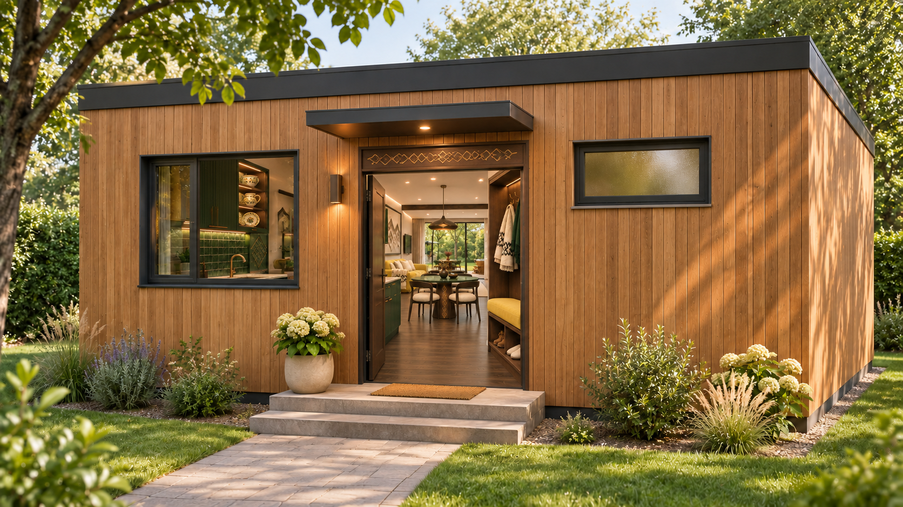

## 02 — Передпокій і жовте сидіння біля шафи

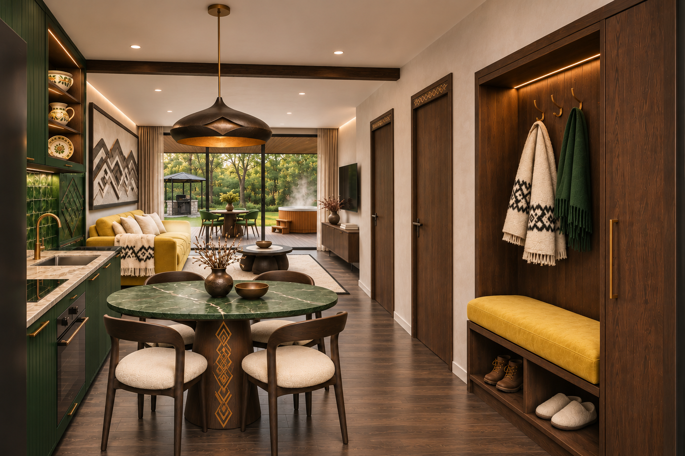

## 03 — Кухня-студія від входу — основа v04

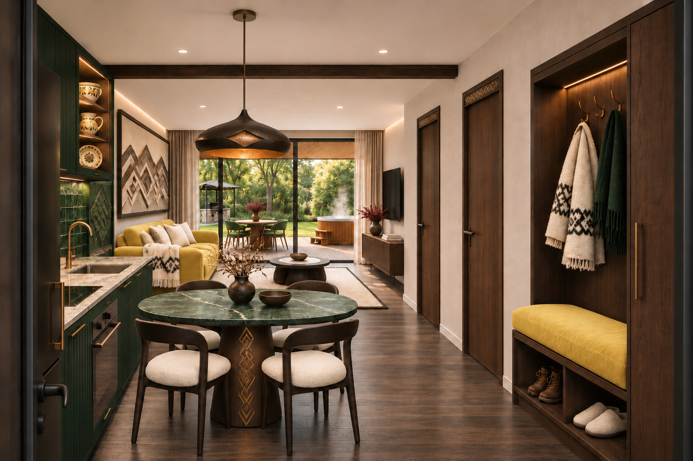

## 04 — Що видно з дивана

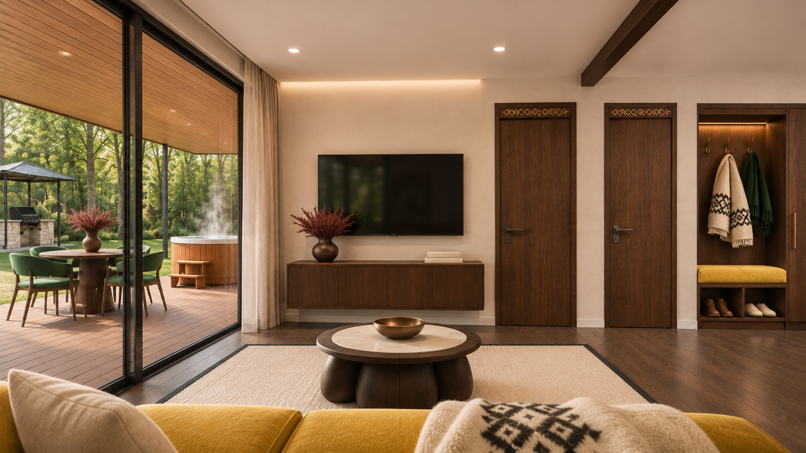

## 05 — Вхід у ванну кімнату

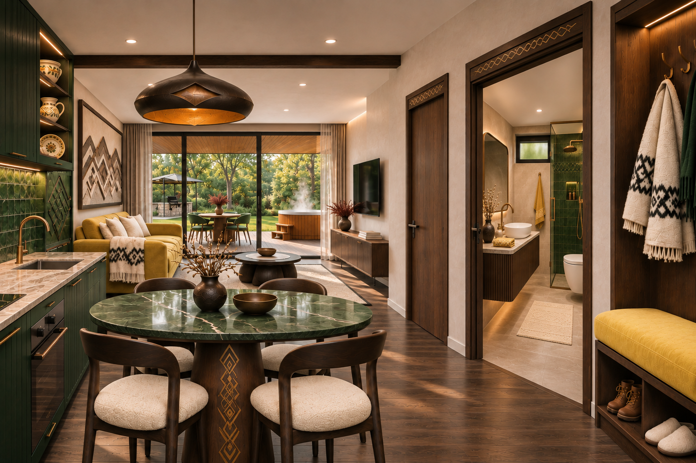

## 06 — Ванна кімната зсередини

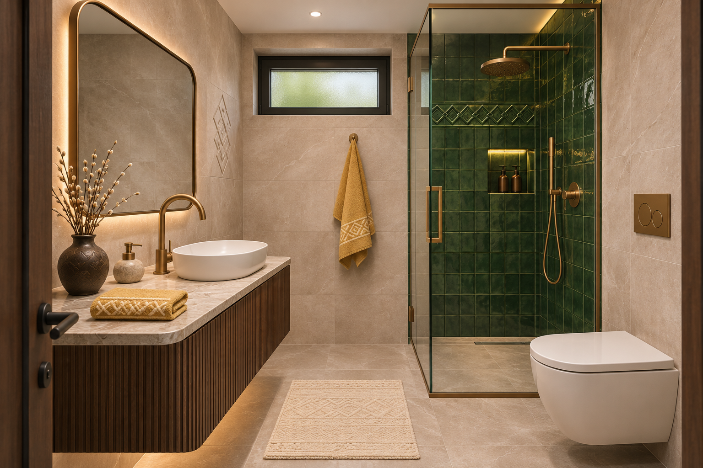

## 07 — Вхід у спальню

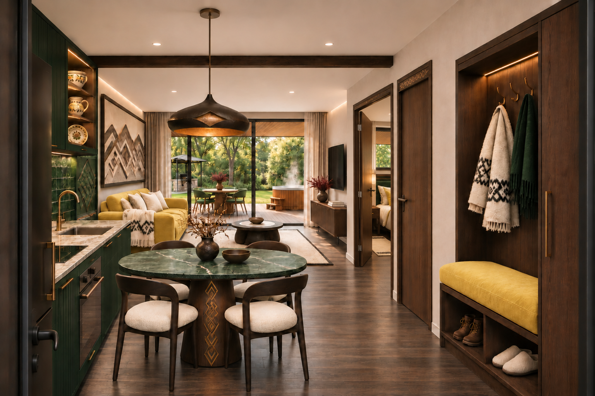

## 08 — Спальня

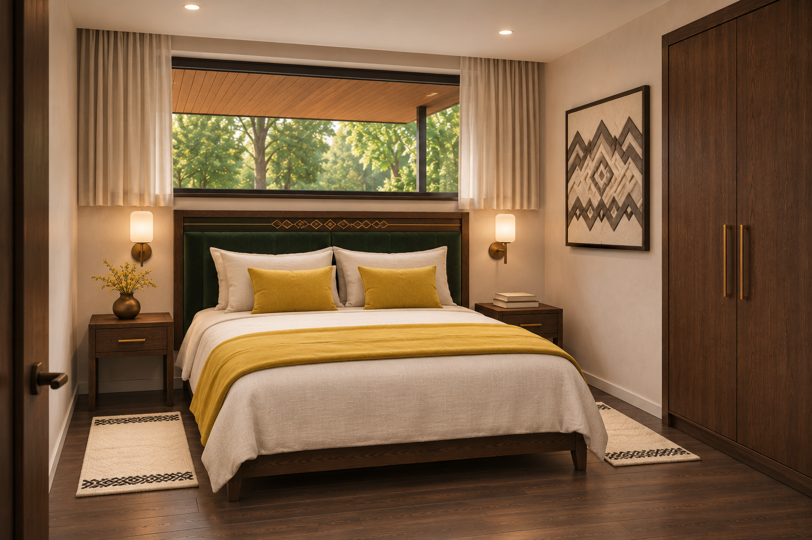

## 09 — Уся накрита тераса й мангал збоку

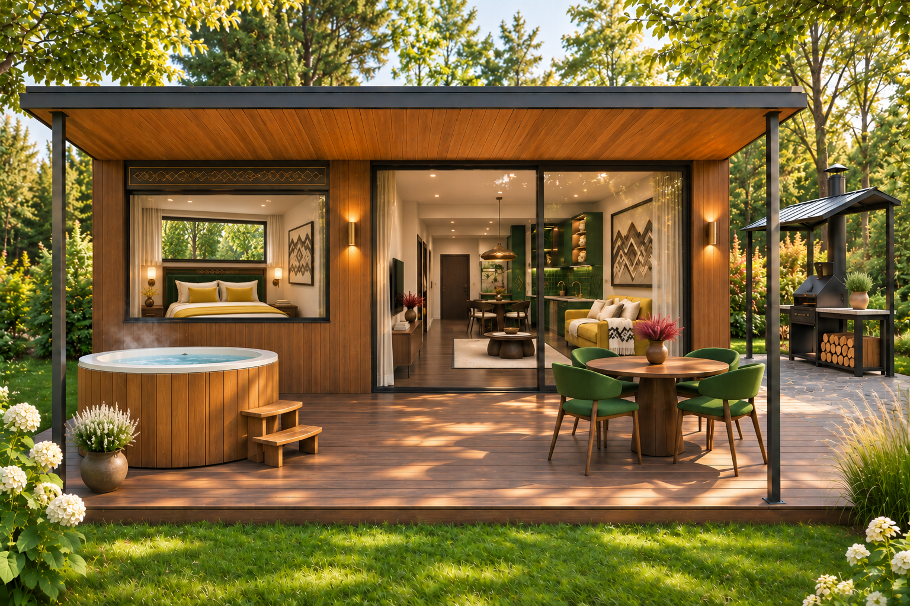

## 10 — З тераси на мангальну зону

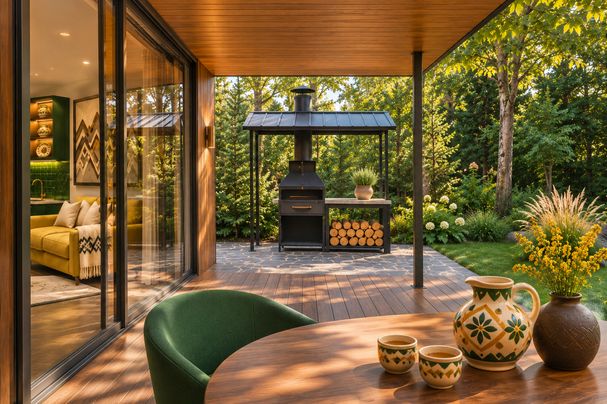

## 11 — Уночі з тераси в кімнату

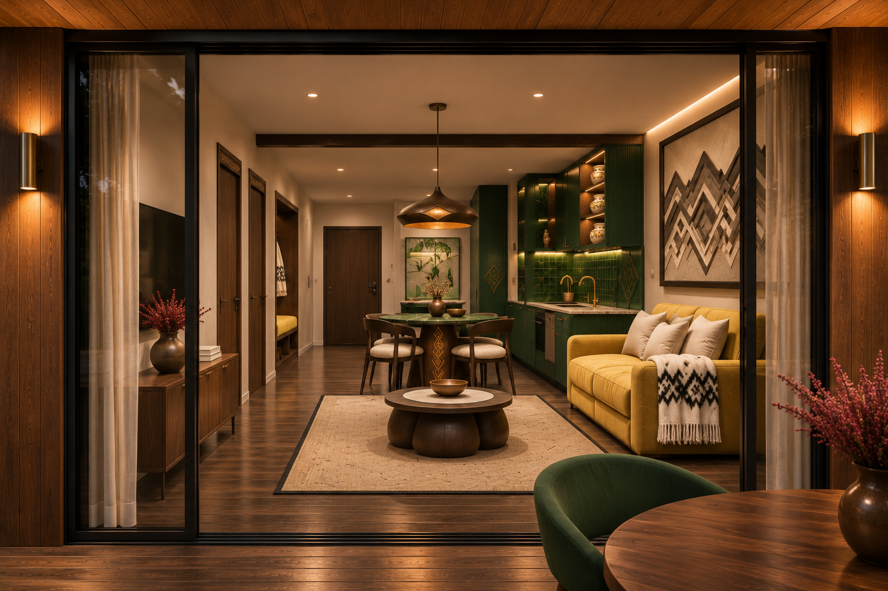

Камера на терасі, погляд через відкритий вихід усередину. Показано вечірнє світло, жовтий диван, смарагдову кухню та обідню зону. Це той самий інтер’єр v04 у нічному освітленні.

## Створення та статус

Використано вбудований ImageGen, кожен новий ракурс — окремий виклик. Кадр 03 — копія вже збереженої студії v04. Повні запити збережені поруч. Основний референс усіх кадрів — власна студія v04; для геометрії входу, зв’язків кімнат і накриття також використано попередні локальні матеріали. Для входу в приватні кімнати використано нові інтер’єри відповідних кімнат, для мангальної зони — загальний вигляд тераси.

[Перелік поточних файлів і референсів](generation-manifest.json).

Зображення показують оформлення й сценарії, а не робочі креслення. Точні розміри, проходи, монтаж і моделі обладнання ще потребують узгодження; дрібні деталі та пропорції між генеративними кадрами можуть відрізнятися. Спальня й санвузол — нові пропозиції оформлення, остаточне погодження попереду. Новий кошторис не складався.

[До всіх варіантів «Гуцулленду»](../README.md)
