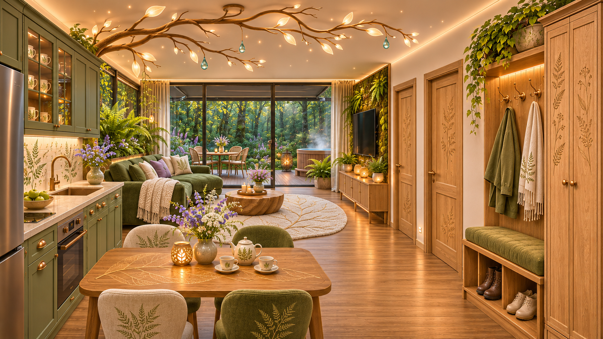
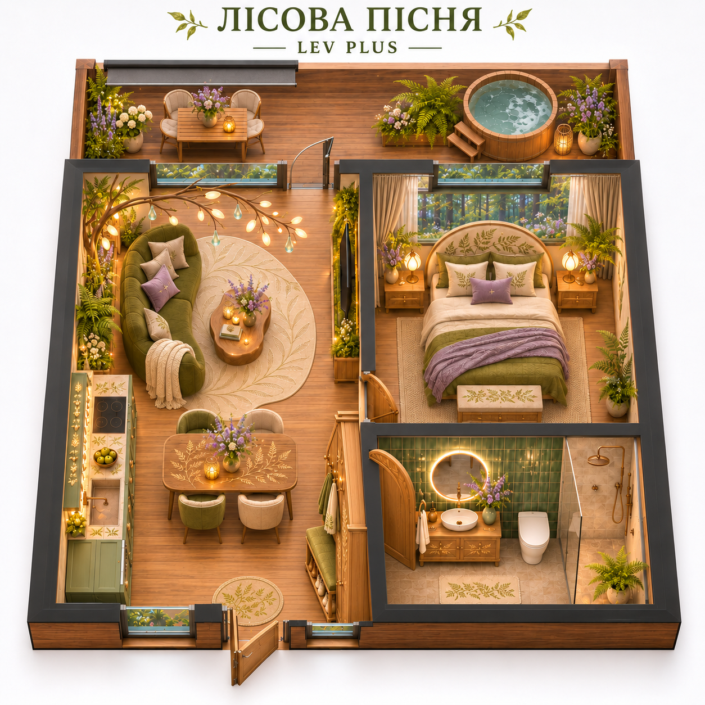

# Лісова пісня — природна концепція за мотивами «Мавки»

**Поточний кадр: [нова перспектива від входу за вихідною схемою планування](entry-redesign-v05-plan-proportions/README.md).** 18.11.2026 користувачка відхилила попередній вигляд як надто довгий тамбур і невідповідний плануванню, а також не схвалила оформлення. Новий кадр побудовано заново з вихідної схеми, зі стриманішою перспективою й компактними меблями. Це художня пропозиція, а не підтвердження точних габаритів; кадр ще не погоджений.

**Попередній відхилений кадр: [ковролін, килимки-камінці та оформлена права стіна](entry-redesign-v04-green-carpet/README.md).** Вимоги до ковроліну, невеликих килимків, стриманого декору й одного видовженого вазона збережено як побажання, але зображена перспектива та конкретний дизайн не погоджені. Подальші ракурси до погодження одного входу не розробляємо.

**Попередній кадр: [зелена плитка, світлі рельєфні стіни та зоряна стеля](entry-redesign-v03-green-floor/README.md).** Наступними правками плитку замінено ковроліном і доопрацьовано праву стіну. Зоряна стеля, ліва рельєфна стіна та TV-інсталяція залишаються в новому варіанті вище.

**Історія збереження 18.11.2026.** За прямим проханням користувачки всі 35 тоді наявних файлів напряму скопійовано в цю папку **«Лісова пісня»**. Кількість і розміри файлів звірено з джерелом. Після цього створено окрему [«Хату Мольфара»](../khata-molfara/README.md), а потім користувачка повернулася до правок «Мавки»; найновіший варіант наведено вище. Попередні версії збережені для порівняння.

**Попередня версія: [густий зелений інтер’єр і яскравіші меблі](entry-redesign-v02/README.md).** Великі вазони та зелень під стелею з цього варіанта відхилено наступним уточненням; орієнтир для наступної роботи — новий кадр із зеленою підлогою й зоряною стелею вище. Зображення нижче та в папці `walkthrough/` залишаються непогодженими напрацюваннями.

18.11.2026. **Робоча назва запропонована асистентом**, остаточну назву стилізації користувачка ще не затвердила. Напрям задано Боженою: будинок на природі, природа продовжується всередині, а інтер’єр теплий і затишний. Натхнення — український мультфільм «Мавка. Лісова пісня». Художнє оформлення v01 для обговорення.

## Попередні зображення — оформлення відхилено

| Ракурс | Файл | Повний запит |
|---|---|---|
| Студія від головного входу | [01-forest-song-studio-entry-v01.png](01-forest-song-studio-entry-v01.png) | [Запит](01-forest-song-studio-entry-v01-prompt.txt) |
| Загальний вигляд — шафа фасадами до кухні, поточний v02 | [02-forest-song-cutaway-storage-v02.png](02-forest-song-cutaway-storage-v02.png) | [Уточнення](02-forest-song-cutaway-storage-v02-prompt.txt) |

Перший [загальний ескіз v01](02-forest-song-cutaway-v01.png) і його [запит](02-forest-song-cutaway-v01-prompt.txt) збережені для історії. На ньому шафа була помилково повернута фасадом до входу. У v02 виправлено орієнтацію шафи; він залишається довідкою з планування, його художнє оформлення відхилено разом із попередньою серією.

## Уточнення шафи — має пріоритет

За прямим уточненням Божени **фасади шафи, гачки й відкриті ніші для взуття дивляться ЛІВОРУЧ, НА КУХНЮ ТА ПЛИТУ**. Шафа стоїть вертикально праворуч від входу, тильною стороною до перегородки санвузла. Блок витягнутий уздовж правої перегородки; з боку головних вхідних дверей видно його бічну стінку. Висока шафа для одягу, гачки, низька банкетка й ніші для взуття мають спільний доступний фронт із боку кухні-студії. Доступ до дверей санвузла зберігаємо.

Фраза попередніх матеріалів «лицем до гостя» означає доступність фасадів зі студії, **а не поворот шафи поперек проходу фасадом до головних вхідних дверей**. Правильний орієнтир — вигляд ізсередини студії; загальний ескіз виправлено поворотом блоку на 90° на підлозі. Це правило застосовуємо до наступних стилізацій цього самого планування.

## Простір

Основа — [останнє одноповерхове планування](../../concept/layout-variants/single-storey/entry-redesign/README.md). Квадратний корпус, прямокутні панорамні вікна, кухня-студія ліворуч, окремі санвузол і спальня праворуч, кожна з власним входом зі студії. Тераса з протилежного від головного входу боку; стіл і крісла ліворуч, купіль праворуч, якщо дивитися зсередини. Нового закритого коридора й додаткових кімнат не додавали.

## Ідея — ліс продовжується в кімнаті

- Зелені рослини біля прозорого скління поєднують інтер’єр із деревами й папоротями зовні. У приміщенні кашпо та вбудовані контейнери по краях, дерев’яні підлоги й вільний прохід.
- Палітра: шавлієва й папоротева зелень, світле дерево, молочний текстиль, делікатний бузковий і краплі бірюзового скла.
- Над вітальнею запропоновано легку декоративну гілку-світильник із листям і скляними краплями. Вона не є деревом, що проростає крізь будинок; кріплення та габарити ще не розроблені.
- М’який зелений диван, молочний плед, килим із жилками листка, ботанічні мотиви на посуді, столі та дерев’яних дверях. Тепле робоче світло й дрібні декоративні світлові точки.
- Біля TV запропоновано зелену панель із мохом/папоротями. Живі чи стабілізовані матеріали, догляд і комплектацію ще обираємо.
- У спальні м’яке узголів’я з мотивом листя, молочна білизна, зелений і бузковий текстиль. У санвузлі зелена плитка, теплий кам’яний відтінок, душ, WC, умивальник і кругле підсвічене дзеркало.
- Накриття тераси — графітова маркіза над сидінням за попереднім напрямом. На загальному оглядовому кадрі вона умовно частково згорнута, щоб бачити меблі. Окремої деталізації мангала в цих двох кадрах не виконували.

Рослини, кольори, меблі й декоративне світло — пропозиції асистента, не затверджена специфікація. Ці художні ескізи не є розмірним чи інженерним проєктом. Точні проходи, дверні дуги, модулі шаф, скління, освітлення та догляд за рослинами потрібно звірити на плані й розгортках; кошторис цієї стилізації не складали.

## Натхнення та генерація

На початку роботи 18.11.2026 переглянуто вебпошук зображень і офіційні описи:

- [Про мультфільм «Мавка. Лісова пісня»](https://mavka.ua/en/about): природа та українські природні локації як основа світу фільму.
- [Творці про Світ Лісу](https://mavka.ua/uk/news/text/183-mavka-lisova-song-official-trailer): образи карпатських пралісів і магічної природи.

Це окреме інтер’єрне переосмислення теми єдності з лісом. Персонажів і логотип мультфільму у візуалах не використовували.

Створено вбудованим ImageGen. Перші два кадри спираються на уточнений оглядовий кадр «Хобітленду» та його ракурс входу з папки `walkthrough` як референси архітектури. Для виправлення v02 використано загальний ескіз v01 цієї концепції та її студію від входу як правильний орієнтир фасадів шафи. Повні запити наведено в таблиці.

## Студія

## Загальний вигляд — шафа фасадами до кухні

[До другого типу](../../README.md)

