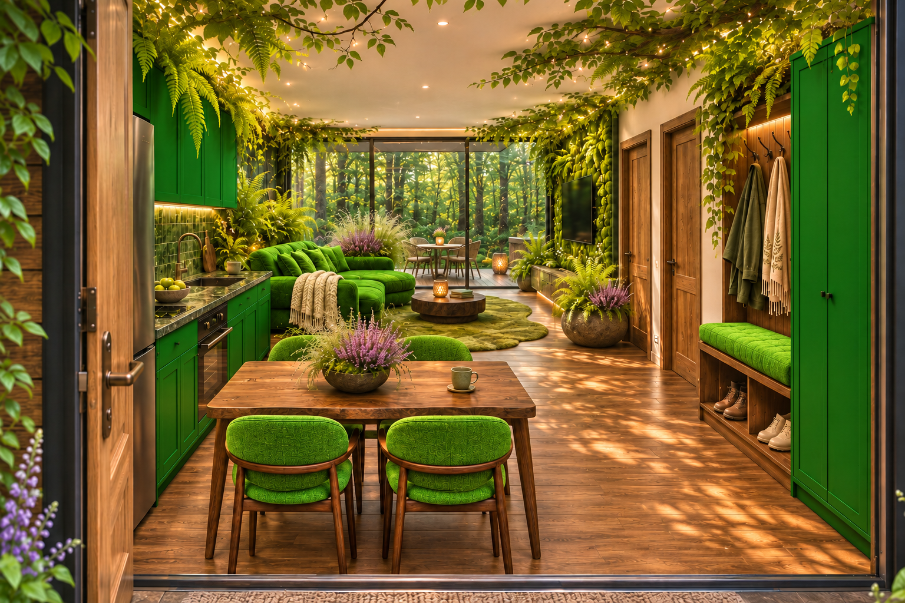

# Лісова пісня — новий вигляд від дверей

**Попередній напрям.** Наступним уточненням користувачка відхилила вазони, квіткові композиції й надлишок рослин усередині. Поточна робота — [зелена підлога, світлі стіни та зоряна стеля](../entry-redesign-v03-green-floor/README.md). Нижче збережено історію цього варіанта.

**Поточний кадр: [яскравіші зелені меблі — v02](02-immersive-forest-entry-brighter-green-v02.png).** За наступним уточненням користувачки від 18.11.2026 насичено зеленою зроблено оббивку дивана, крісел і банкетки, а також фасади кухні та шафи. Планування, ракурс, рослини, вазони й TV-інсталяція збережені. [Повний запит до вбудованого ImageGen](02-immersive-forest-entry-brighter-green-v02-prompt.txt). Попередній v01 залишено для порівняння; v02 ще для погодження, інші ракурси не розробляємо.

18.11.2026. **Поточна єдина пропозиція для погодження.** Користувачка відхилила попередній дизайн загалом. Їй сподобалася тільки зелена інсталяція з мохом і папоротями навколо TV. Нове завдання — значно яскравіша й густіша зелень, великі вазони з травами та квітучими рослинами, відчуття життя й сну в лісі, зі збереженням домашнього тепла.

**Спочатку погоджуємо один вигляд від головних вхідних дверей. Інші ракурси та кімнати далі не опрацьовуємо до її погодження або наступних правок.** Новий кадр ще не погоджений.

- [Один новий вигляд від дверей](01-immersive-forest-entry-v01.png).
- [Повний запит до вбудованого ImageGen](01-immersive-forest-entry-v01-prompt.txt).
- [Наданий користувачкою референс — подобається тільки інсталяція біля TV](reference-approved-tv-installation.png).

## Що показано

Густі папороті й листя по периметру стелі, більша зелена композиція навколо TV, глибокий зелений диван і кухня, м’який зелений килим з обрисом мохової галявини. Великі округлі вазони з папоротями, тонкими травами й фіолетовими вересоподібними квітучими рослинами. Підлога дерев’яна, прохід збережено; біля скла внутрішня зелень візуально переходить у ліс зовні.

Стару декоративну золоту гілку-люстру, молочний килим і повторювані ботанічні гравіювання меблів у новому рішенні прибрано. Тепле світло дрібними точками приховане серед зелені; звичайні робочі світильники доповнюють його.

Планування залишається попереднім: кухня й студія ліворуч, окремі двері санвузла та спальні праворуч. Висока вертикальна шафа з банкеткою праворуч при вході стоїть фасадами до кухні та плити, спинкою до перегородки санвузла. Шафа й взуттєві ніші доступні зі студії.

Це художня пропозиція, не погоджений набір матеріалів чи рослин. Вересоподібне цвітіння показано як бажаний образ вазонів; конкретні види рослин для приміщення, умови утримання, догляд, тип зеленої інсталяції та кріплення під стелею ще не обрані. Щорічне цвітіння конкретної кімнатної композиції цим ескізом не підтверджено.

## Генерація

Створено **одне** нове зображення вбудованим ImageGen. Переглянуто після генерації: ракурс від дверей, зелену TV-інсталяцію збережено, зелені й великих вазонів більше, шафа вертикальна з фасадами до кухні. Планування та точні проходи належить перевіряти на розмірному плані.

Референс архітектури й ракурсу — попередній `../walkthrough/02-open-main-door.png`; оздоблення цього попереднього кадру не погоджене. Другий референс — надане користувачкою зображення, з якого до нового дизайну переносимо тільки інсталяцію навколо TV.

[До матеріалів напряму](../README.md)

