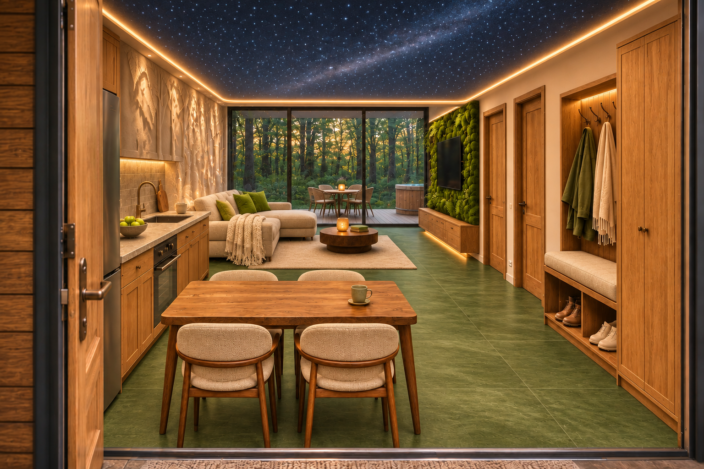

# Лісова пісня — зелена підлога й зоряна стеля

**Попередній варіант.** За наступною прямою правкою користувачки плитку замінено ковроліном, додано килимки-камінці та переоформлено праву стіну з дверима й вішалкою. [Поточний кадр](../entry-redesign-v04-green-carpet/README.md). Нижче історія попереднього рішення.

18.11.2026. **Один поточний вигляд від головних дверей для обговорення.** Користувачка повернулася до напряму «Мавки» й уточнила: природний характер створюємо насамперед підлогою, стінами та цікавою натяжною стелею із зоряною підсвіткою. Зелені має бути виразно, але не на всіх поверхнях одразу. Великі вазони, квіткові композиції та надмірну зелень усередині відхилено. Конкретний новий дизайн ще не погоджений.

- [Поточне зображення](01-entry-green-floor-star-ceiling-v01.png).
- [Повний запит до вбудованого ImageGen](01-entry-green-floor-star-ceiling-v01-prompt.txt).

## Поточна пропозиція

За останнім міркуванням користувачки основний зелений акцент перенесено на **матову підлогу**: запропоновано зелений кам’яний/мінеральний вигляд великоформатної плитки. Це пропозиція оздоблення, конкретний матеріал і модель не обрані.

**Стеля** — єдина рівна темно-синя зоряна площина з дрібними світловими точками та теплим периметром. Це візуальний задум натяжної стелі; спосіб створення зоряного малюнка, обладнання, розміри й кошторис ще не розроблені.

**Стіни** світлі, теплі, з природним рельєфом рослинності та м’яким підсвічуванням. Кухня й шафа дерев’яні, диван та сидіння лляного світлого відтінку, зелені подушки локальні. Це колірна пропозиція асистента для балансу із зеленою підлогою; попередня вимога яскравіших зелених меблів не перенесена буквально на всі меблі в цьому новому варіанті.

У кадрі збережена **раніше вподобана зелена інсталяція навколо TV**, але прибрано окремі вазони, вересоподібні квітучі композиції та звисаючі рослини під стелею. Ліс за прозорим склом залишається головним природним оточенням.

## Незмінна основа

Те саме планування й ракурс від входу: кухня та студія ліворуч, окремі двері санвузла та спальні праворуч, вихід на терасу попереду. Шафа стоїть вертикально праворуч при вході, фасадами до кухні та плити, спинкою до перегородки санвузла. Нових кімнат чи вікон не додавали.

Створено **одне** нове зображення вбудованим ImageGen на основі попереднього входу з яскравішими зеленими меблями. Після генерації переглянуто: зелена підлога, зоряна стеля, світлі стіни, збережена TV-композиція й відсутність окремих вазонів. Планування, проходи та всі матеріали далі перевіряємо на розмірному плані. Інші ракурси до погодження цього кадру не розробляємо.

[До матеріалів Лісової пісні](../README.md)

