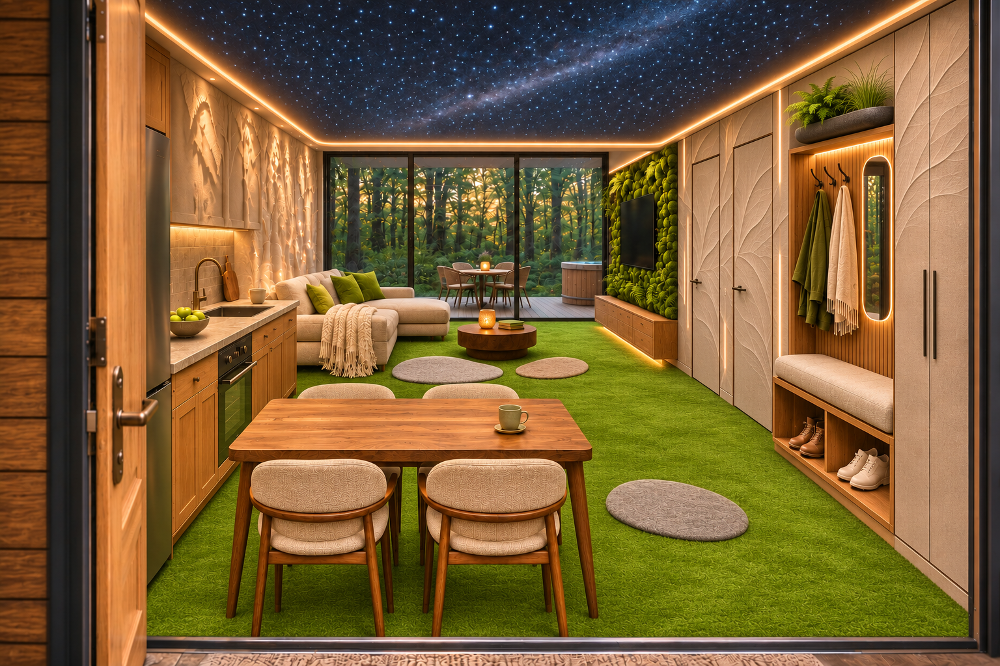

# Лісова пісня — ковролін, килимки-камінці та оформлена права стіна

**Кадр відхилено наступною правкою користувачки:** вигляд надто довгого тамбура не відповідає її розумінню планування, оформлення не подобається. [Нова перспектива за вихідною схемою](../entry-redesign-v05-plan-proportions/README.md). Нижче історія попередньої пропозиції.

18.11.2026. **Один поточний ракурс від головного входу для погодження.** За прямими правками користувачки зелену плитку замінено яскраво-зеленим ковроліном, додано невеликі килимки у формі камінців і переоформлено праву стіну з дверима та зберіганням. Новий дизайн ще не погоджений.

- [Зображення](01-entry-green-carpet-pebble-rugs-v01.png).
- [Повний запит до вбудованого ImageGen](01-entry-green-carpet-pebble-rugs-v01-prompt.txt).

## Що змінили

**Підлога:** суцільний м’який ковролін яскравого трав’яного зеленого кольору. Поверх нього три окремі невеликі пласкі килимки у формі округлих річкових камінців: сірі й сіро-піщані. Це текстиль, не справжні камені, газон чи плитка.

**Права стіна:** двері санвузла та спальні й фасади високої шафи об’єднано світлими фактурними панелями з рельєфом жилок листка. Дверні прорізи на тих самих місцях; двері з ручками читаються в загальній композиції. Тонкі темні деталі та теплі вертикальні світлові смуги додають технологічного характеру.

**Зона входу:** дерев’яна ніша з акуратними гачками, підсвіченим видовженим дзеркалом, світлою банкеткою й доступними взуттєвими нішами. Висока шафа вертикальна, фасадами до кухні та плити, спинкою до перегородки санвузла.

**Один вазон:** видовжена темна капсулоподібна ємність на верхній полиці зони входу з компактними папоротеподібними рослинами й тонкою травою. Це стриманий акцент; пальм і великих квіткових композицій не додавали. Конкретні рослини та обладнання вазона ще не підбирали.

Збережено зоряну стелю, рельєф лівої стіни, інсталяцію біля TV, меблювання та планування. Природні образи поєднані з чіткими панелями, прихованим світлом і практичним зберіганням.

## Генерація та статус

Створено одне зображення вбудованим ImageGen на основі [попереднього кадру із зеленою плиткою](../entry-redesign-v03-green-floor/01-entry-green-floor-star-ceiling-v01.png). Після генерації переглянуто: ковролін без плиткових швів, три килимки, переоформлена права стіна та двері, дзеркало/гачки/взуття й один видовжений вазон.

Показано ескіз оздоблення. Матеріали, вузли панелей, освітлення, розміри та кошторис ще не розроблені; планування й проходи звіряємо на розмірному плані. Інші ракурси цієї стилізації до погодження одного входу не розробляємо.

[До Лісової пісні](../README.md)

