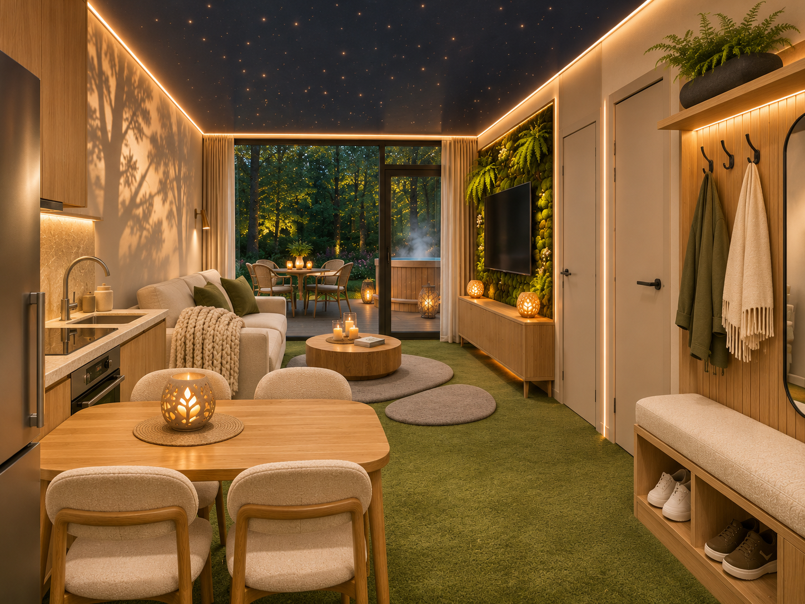

# Лісова пісня — новий ракурс за пропорціями плану

18.11.2026. **Один новий кадр від входу для обговорення.** Користувачка відхилила попередній вигляд: він здавався довгим тамбуром, не відповідав її розумінню планування, а оформлення не вражало. Новий кадр ще не погоджений.

- [Зображення](01-entry-compact-plan-v01.png).
- [Повний запит до вбудованого ImageGen](01-entry-compact-plan-v01-prompt.txt).

## Що змінили

Нову перспективу побудовано з [вихідної схеми планування](../../../concept/layout-variants/single-storey/entry-redesign/03-smaller-bathroom-storage.png), а не повторним редагуванням попереднього видовженого кадру. Студія займає ліву частину квадратного будинку; справа за перегородкою санвузол і спальня. Пропорції візуальні: вихідний ескіз не містить перевірених розмірів.

У запиті задано звичайнішу перспективу з меншим перебільшенням глибини, компактні кухонні модулі, менший стіл і звичайний диван. Найближчі меблі природно частково обрізано кадром. Скляна задня стіна ближча за відчуттям, між входом і склом одна обідня та одна диванна групи. Окремого довгого коридора не додавали.

Оформлення спрощено: тепле дерево, світла оббивка, природні тіні на світлій стіні, стримані зоряні точки й один моховий акцент біля TV. Зелений текстильний ковролін, групу килимків-камінців та видовжений вазон з невисокою зеленню збережено як напрям попередніх побажань. На цьому кадрі зелений колір виглядає спокійнішим через світло; це художня пропозиція, не остаточний вибір відтінку чи матеріалу.

## Перевірка й межі

Після генерації переглянуто взаємне розташування: кухня й диван ліворуч, TV навпроти на правій перегородці, двоє приватних дверей праворуч, зберігання біля головного входу, скління на терасу попереду. Шафа має залишатися вертикальною, фасадами до кухні та плити.

**Це не підтвердження точної геометрії.** Новий ракурс є художньою інтерпретацією нерозмірного плану. Точну ширину студії, відстані, дверні дуги та місткість меблів ще потрібно задати в розмірному плані/3D-моделі. Розміри будинку з цього зображення не вимірювали, бюджет не оновлювали. Інші ракурси до погодження одного входу не розробляємо.

## Генерація

Створено вбудованим ImageGen. Перший референс — вихідна схема з меншим санвузлом. Другий — наданий користувачкою кадр із вподобаною TV-інсталяцією, використаний тільки як референс моху й папоротей навколо TV. Попередній довгий ракурс як референс камери не використано.

[До Лісової пісні](../README.md)

