# Третій тип — прогулянка будинком

17.11.2026. Тринадцять окремих великих ракурсів нового одноповерхового будинку з двома закритими спальнями. [План згори](../01-two-bedrooms-facing-doors.png) · [Опис схеми](../README.md).

**За рішенням Божени залишаємо душову кабіну, туалет та умивальник із дзеркалом.** Комплектація санвузла обов’язкова; дзеркало показано над умивальником у кадрах студії та санвузла. Решта серії — пропозиція для обговорення.

На плані вхід із двору внизу, тераса вгорі. Спальня 1 ліворуч від входу, спальня 2 праворуч; кожна має власні двері з холу. Зберігання одягу й взуття праворуч при вході, фасадами до людини. Санвузол далі ліворуч, студія з виходом на терасу в глибині.

| № | Ракурс | Зображення |
|---|---|---|
| 01 | Передній вхід із двору; по вікну кожної спальні з боків | [Відкрити](01-courtyard-front.png) |
| 02 | Що бачимо при вході: зберігання праворуч, двері спалень і прохід до студії | [Відкрити](02-from-main-entry.png) |
| 03 | Вхід у першу спальню з холу | [Відкрити](03-bedroom-one-doorway.png) |
| 04 | Перша спальня зсередини, у бік шафи й дверей | [Відкрити](04-bedroom-one-interior.png) |
| 05 | Вхід у другу спальню з холу | [Відкрити](05-bedroom-two-doorway.png) |
| 06 | Друга спальня зсередини, у бік шафи й дверей | [Відкрити](06-bedroom-two-interior.png) |
| 07 | Кухня зблизька | [Відкрити](07-kitchen.png) |
| 08 | Студія: кухня, диван навпроти TV, обідня зона; ліворуч вхід до санвузла | [Відкрити](08-living-studio.png) |
| 09 | Санвузол від дверей: душова, туалет, умивальник із дзеркалом | [Відкрити](09-bathroom.png) |
| 10 | Що бачимо, сидячи на ліжку першої спальні | [Відкрити](10-bedroom-one-from-bed.png) |
| 11 | Що бачимо, сидячи на ліжку другої спальні | [Відкрити](11-bedroom-two-from-bed.png) |
| 12 | Вихід зі студії на терасу: стіл ліворуч, купіль праворуч | [Відкрити](12-studio-to-terrace.png) |
| 13 | Тераса із саду: зворотний ракурс на скляний фасад студії | [Відкрити](13-terrace-from-garden.png) |

## Перегляд

### 01 — вхід із двору
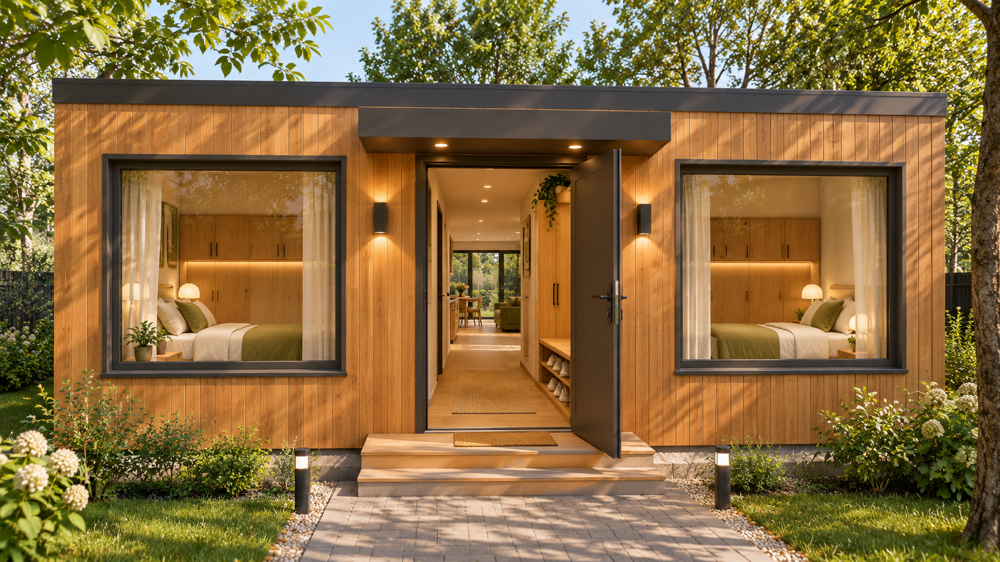

### 02 — від вхідних дверей
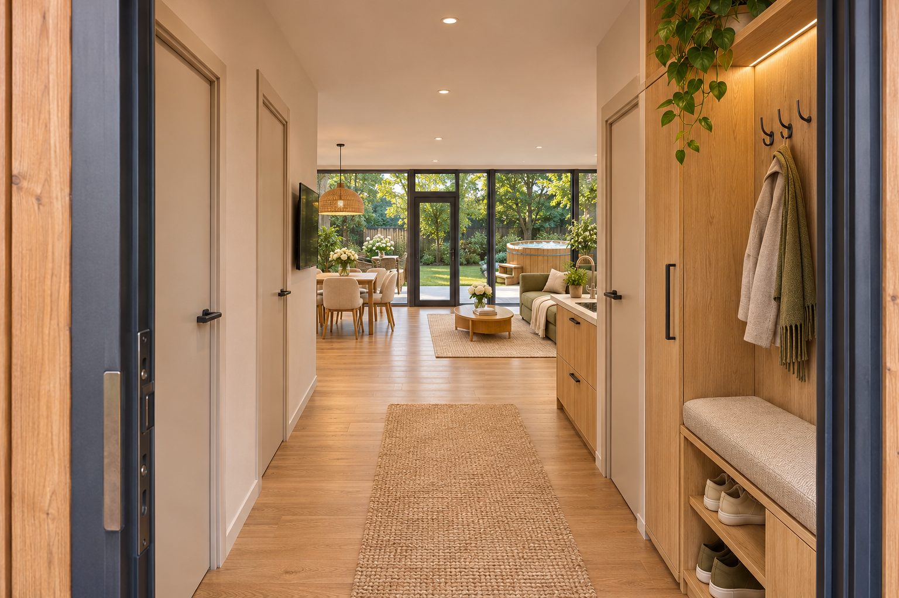

### 03 — вхід у спальню 1
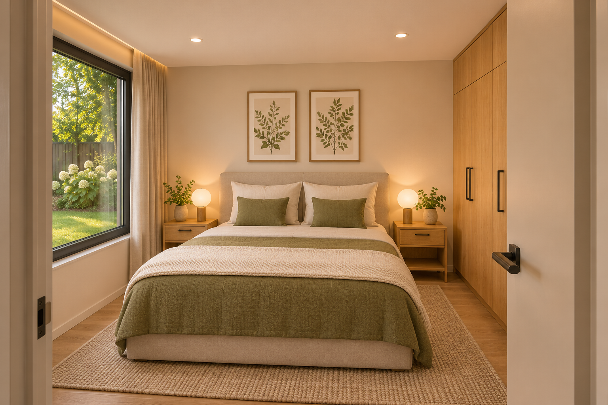

### 04 — усередині спальні 1
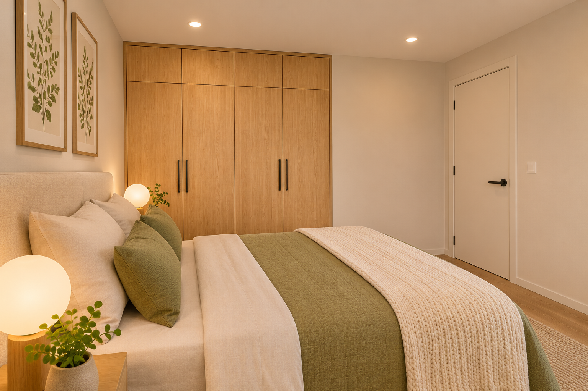

### 05 — вхід у спальню 2
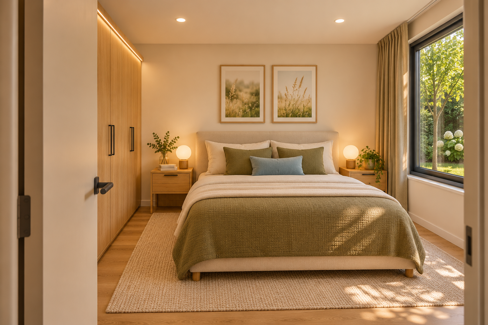

### 06 — усередині спальні 2
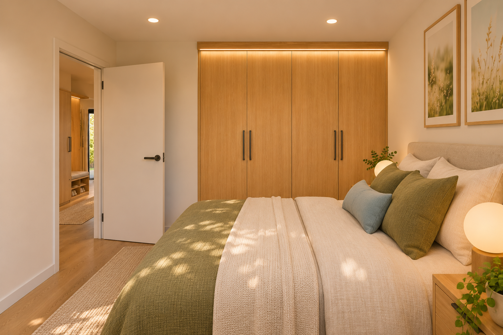

### 07 — кухня
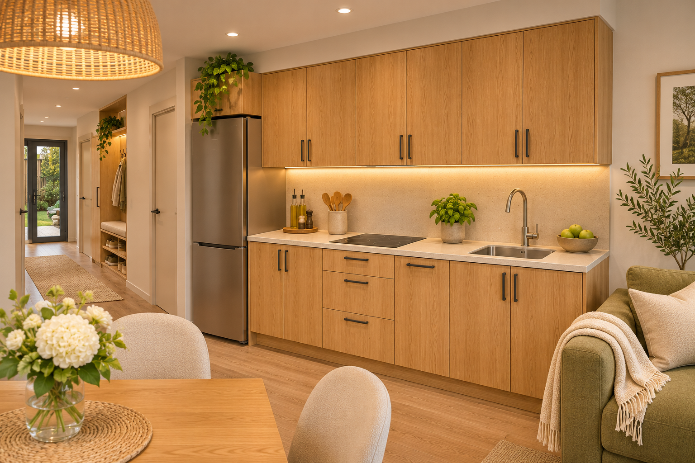

### 08 — студія
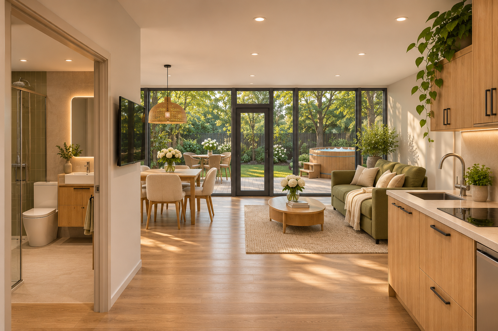

### 09 — санвузол з умивальником і дзеркалом
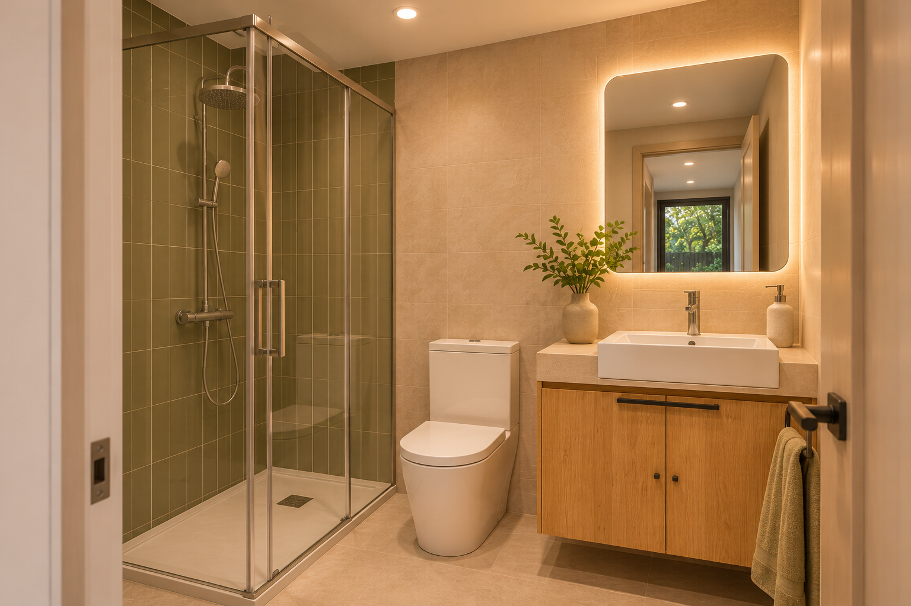

### 10 — з ліжка спальні 1
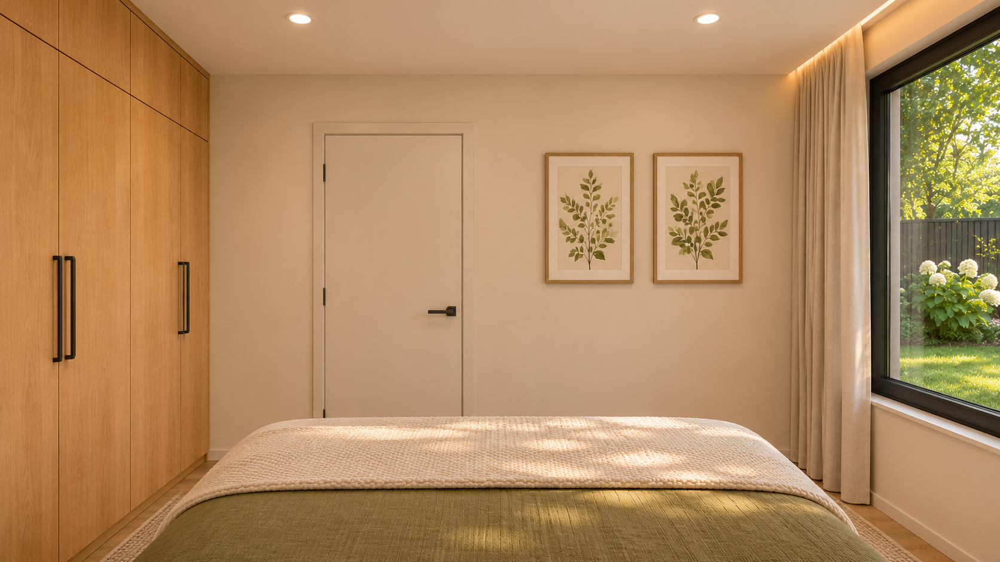

### 11 — з ліжка спальні 2
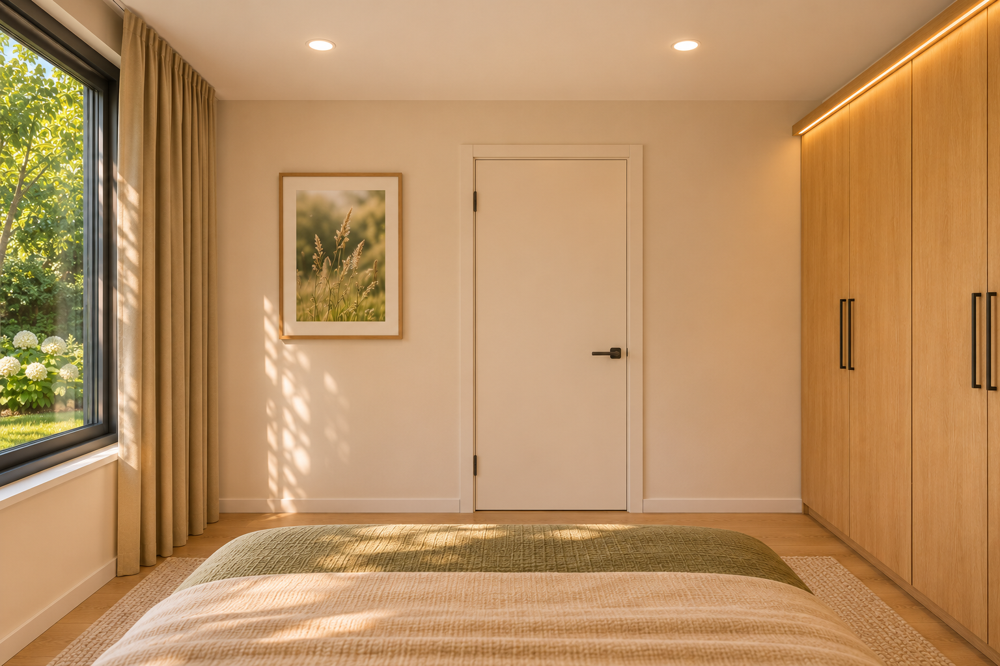

### 12 — вихід на терасу
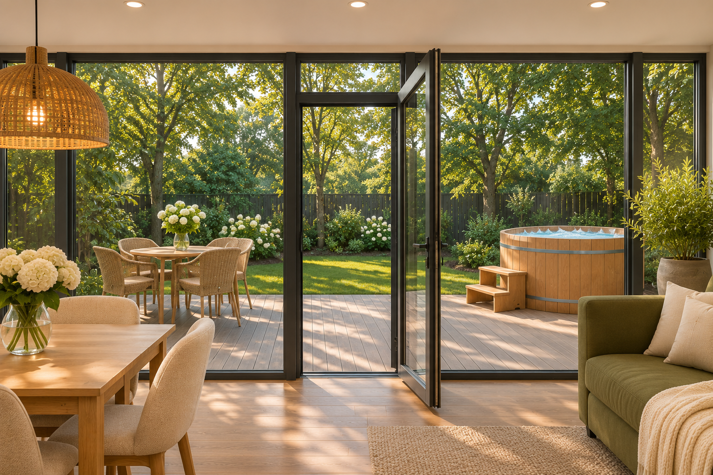

### 13 — тераса із саду
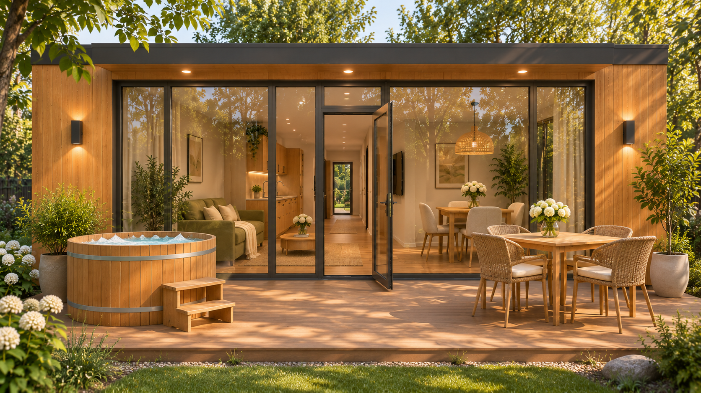

## Статус і джерела

Створено вбудованим ImageGen за планом та вже створеними ракурсами цієї серії. Запити збережено поруч із зображеннями у файлах `*-prompt.txt`; додаткові вказівки й використані референси — у [generation-notes.md](generation-notes.md).

Це концептуальні візуалізації, а не обмірний проєкт: між кадрами можуть відрізнятися дрібні деталі й пропорції. Площі за ними не вимірювали. [Попередній кошторис цієї версії](../four-friends-latest-layout-budget-2026-11-17.md) складено окремо за робочим припущенням 8 × 8 м / 64 м². Фасад, навіс над входом, озеленення, купіль і меблювання тераси показано як пропозиції; вони не означають окремого погодження комплектації.
